# Crazy balls changes

Completed milestones are grouped by the behavior they expose today. The screenshots below were refreshed through Unreal Editor MCP on **November 8, 2026**. Each caption identifies what is visible; historical behavior stays in Game evolution. Internal changes use source or recorded runtime data where a still image cannot establish them.

## Current game evidence

The captured level overrides the C++ defaults: two active balls, ten non-player rebounds per ball, four contacts to win level 1, and 100 bounces to lose. Its next level requires five contacts and allows 98 bounces. These are the current level settings, not changes to the default rules.

### Startup, saved sessions, and starting fresh

**Tasks 18–19, 21–23, 29–30, 40, and 43.** The startup menu brings together New Game, Continue, Delete Save, Exit, and the saved-session summary.

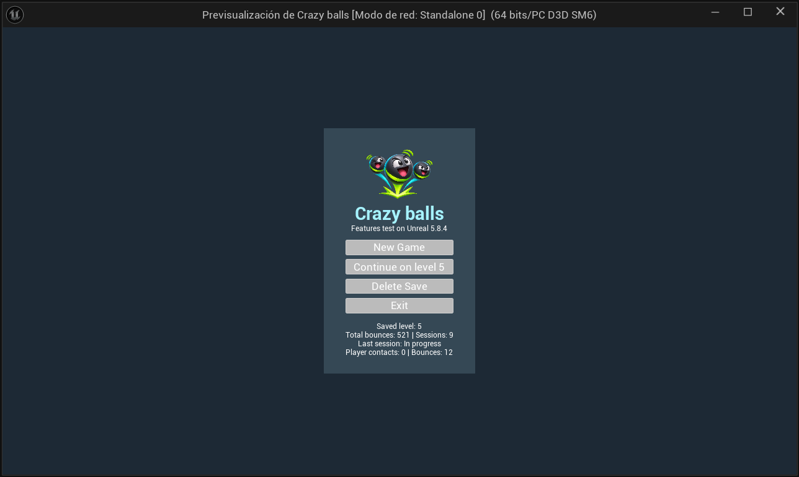

*Saved level 5, 521 aggregate bounces, nine sessions, and the latest session's status/counts are visible. Continue names the saved level. This still establishes the displayed summary, not the behavior of every button.*

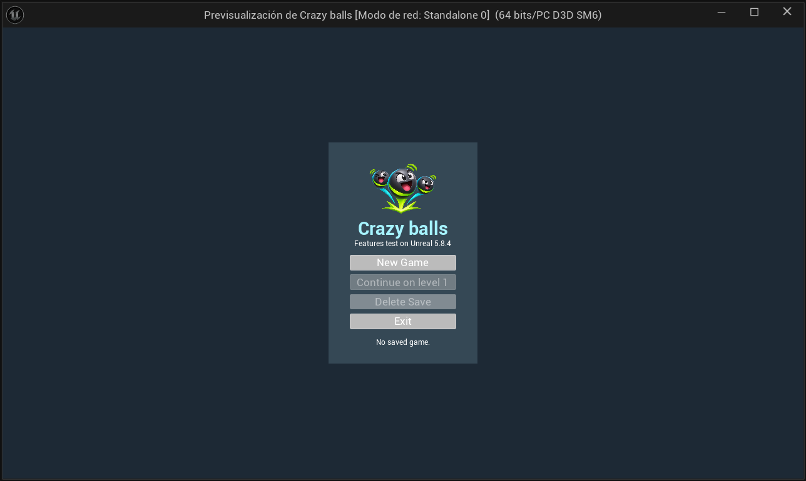

*After Delete Save, No saved game is displayed and Continue and Delete Save are disabled. New Game subsequently started at level 1 with zero counts.*

### Arena, ball activity, and live state

**Tasks 1–6, 12–13, 35, and 43–44.** Gameplay keeps the character, balls, arena, objective HUD, and debug state visible together.

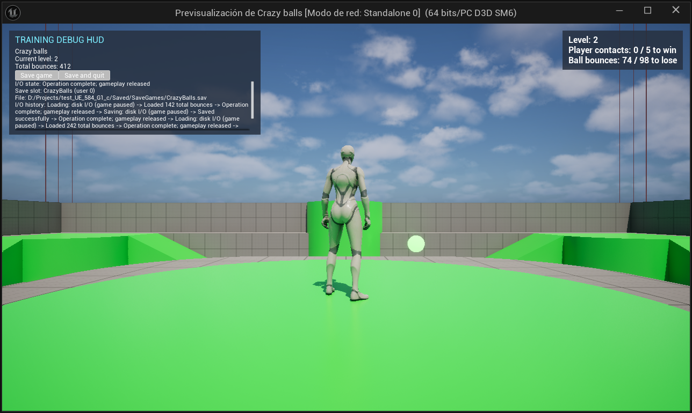

*Level 2 appears in both HUDs. The session has 74 of 98 permitted non-player bounces, while the aggregate total is 412. The arena and a moving ball are visible; one still does not establish trajectories, collision blocking, or pool reuse.*

### Saving and continuing

**Tasks 14–16, 30, and 40.** Save diagnostics show the operation, slot, physical path, and completion history.

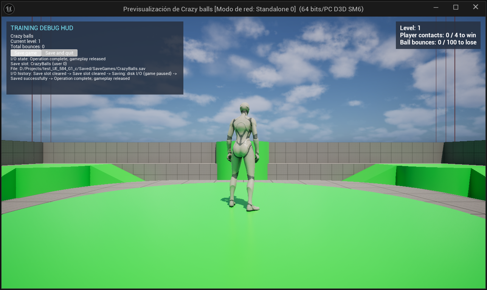

*Save game reports Saved successfully followed by Operation complete; gameplay released. The slot is CrazyBalls and the path is under Saved/SaveGames. Task 16's deliberate preview holds were an earlier teaching milestone; the current flow has asynchronous I/O without those holds.*

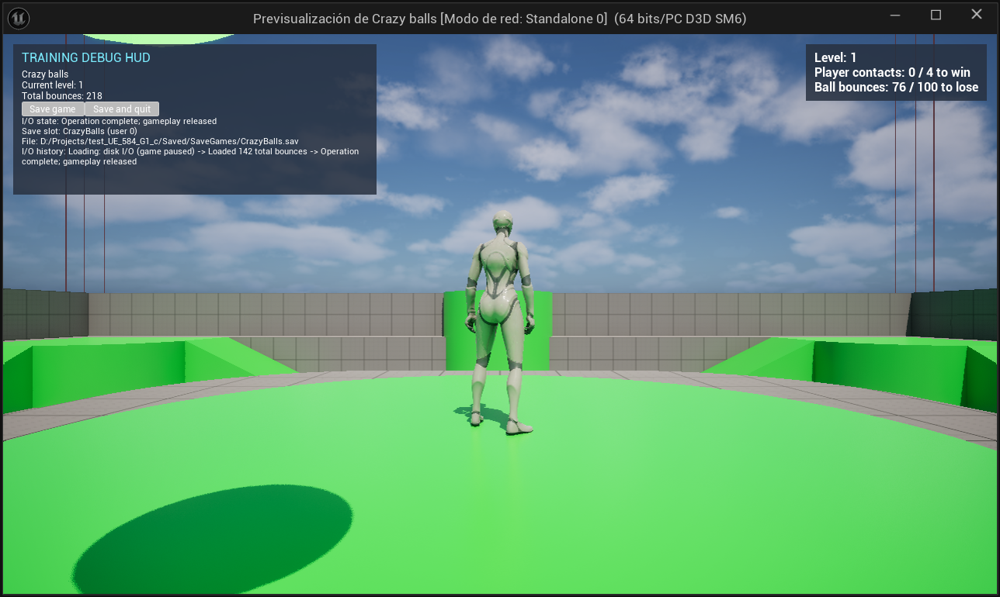

*Continue loaded 142 aggregate bounces; subsequent play increased the total to 218, including 76 bounces in this session. The level remains 1. The image shows loaded-state diagnostics, not save failure or forced-shutdown handling.*

### Pause and resume controls

**Task 24.** Pause presents Resume Game, Main Menu, Exit, and the last saved total.

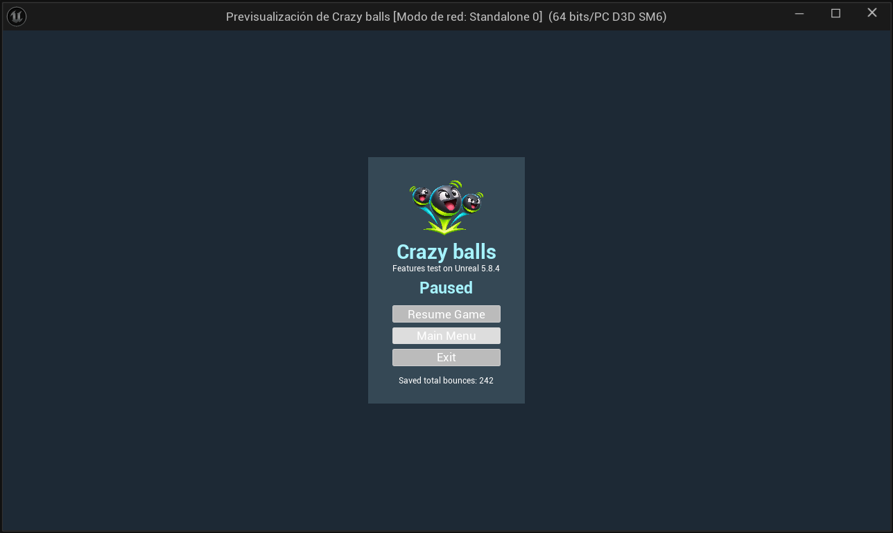

*The current pause view shows a saved total of 242. This capture invoked the existing PauseSession action through the MCP console. PIE's editor Escape shortcut stopped PIE during this session, so this image does not establish the standalone Escape input path.*

### Defeat and Retry

**Tasks 38, 42, and 46–47.** A losing session presents Retry and Exit and saves its result.

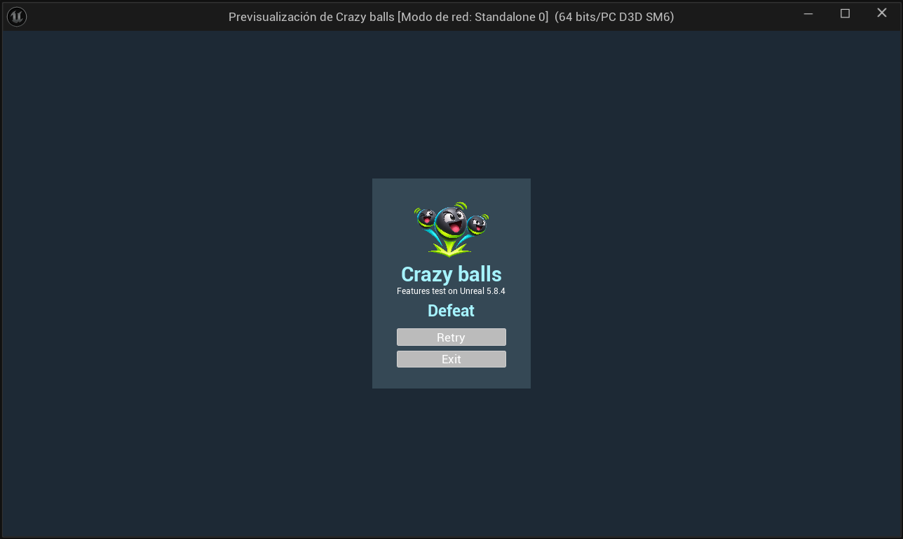

*The capture session reached Defeat naturally at 100 non-player bounces. The obsolete Continue action is absent.*

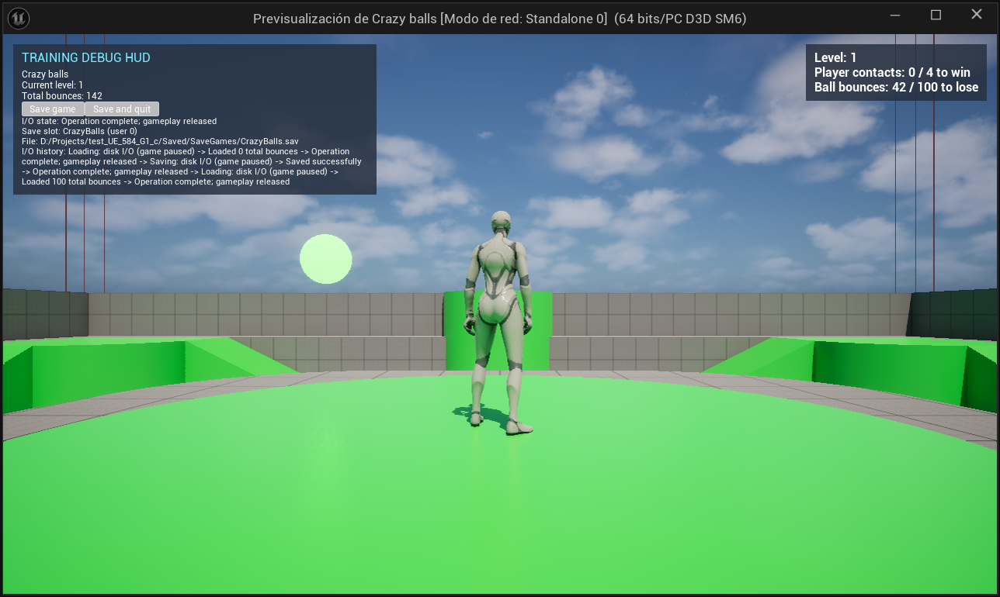

*Retry loaded the saved aggregate of 100 and retained level 1. Subsequent play shows 42 session bounces and an aggregate of 142; the original four-contact and 100-bounce targets remain.*

### Victory and the next level

**Tasks 37, 42–43, 47, and Bug 2.** Victory offers Continue, which starts the next gameplay level.

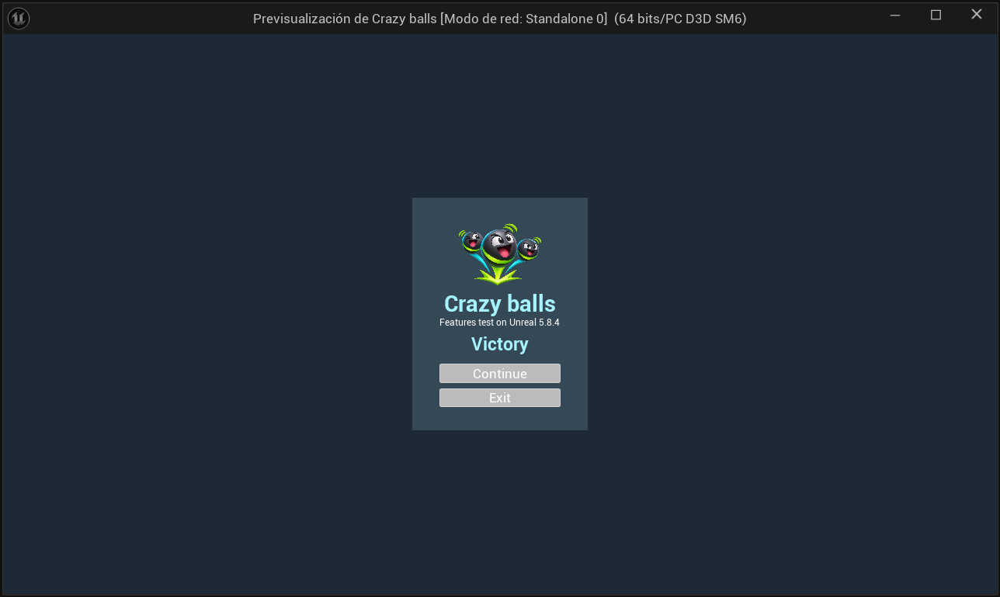

*Victory presentation was triggered through the existing FinishSession(true) API for this capture. This demonstrates the result view and subsequent progression flow, not a victory earned through player contacts.*

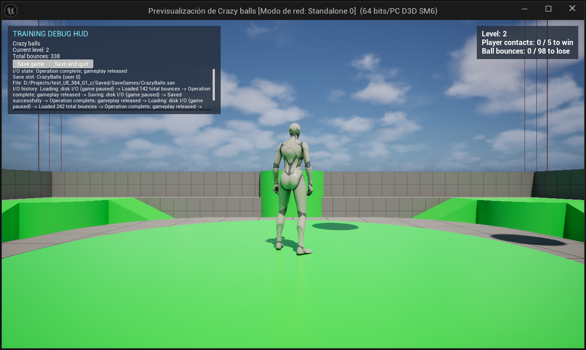

*Clicking Continue entered level 2 with fresh session counts, retained aggregate progress, and recalculated targets of five contacts and 98 bounces. It entered gameplay directly rather than returning to the startup menu.*

### Architecture documentation

**Task 51.** The architecture diagrams describe the patterns behind these examples, with separate responsibility scopes for gameplay, UI, workflow, game logic, and non-UE helpers.

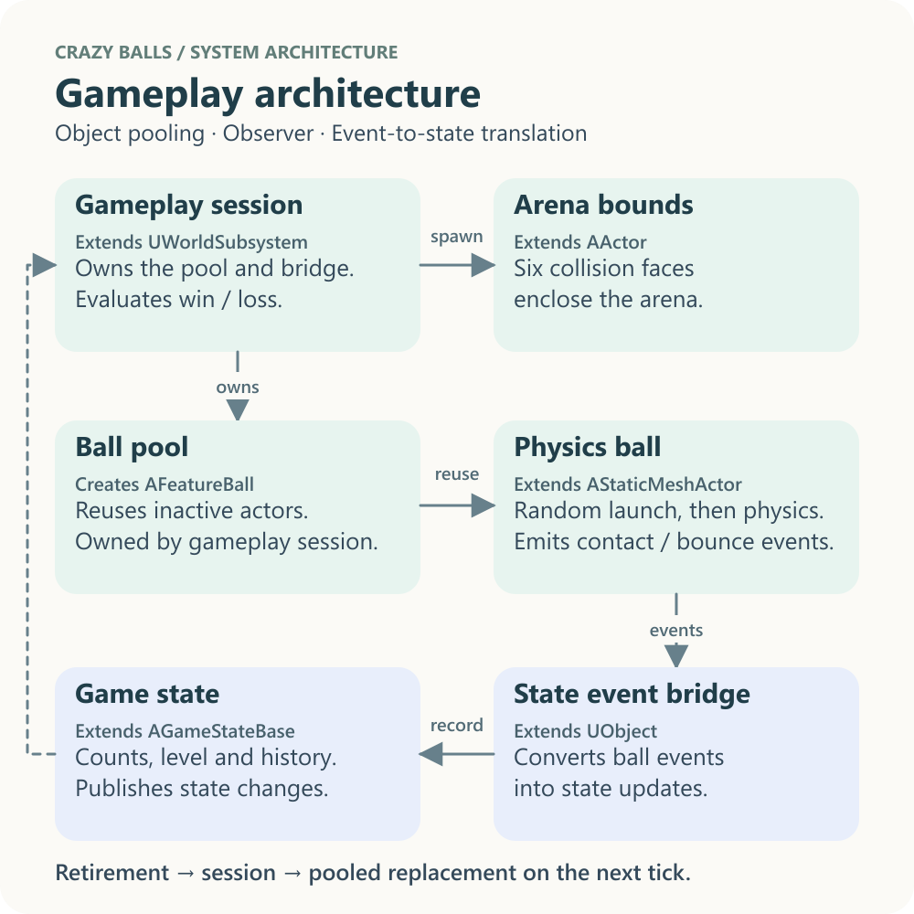

*The gameplay diagram illustrates event publication, the focused state bridge, and pooled actor reuse. It documents the design; it is not runtime evidence or a performance measurement.*

## Changes that need evidence beyond a still image

The visible outcomes above cover the UI portions of the milestones. The details below require code, build metadata, or event sequences. Source references establish implementation, not a successful runtime test. The capture record preserves observed settings, pool-reuse messages, saves, and results; no new Gauntlet run or benchmark was performed.

Deprecated source reference: `Source/TestFeatures/Features_NonUE/FeatureBallSpawner.cpp` was removed; pooling and replacement scheduling now belong to [FeatureBallManager](Source/TestFeatures/Features/Gameplay/FeatureBallManager.cpp). The descriptions and capture evidence below retain their historical context.

| Tasks / area | Current implementation and evidence |
| --- | --- |
| 1–6: creation and lifecycle | Indexed names, randomized launches, and lifecycle logging are implemented by the spawner (`FeatureBallSpawner`, deprecated) and [ball](Source/TestFeatures/Features/Gameplay/Actors/FeatureBall.cpp). The [capture record](docs/validation/2026-11-08-capture-evidence.txt) records the level's actual two-ball setup. |
| 7–11, 36, 45, 52: reuse and event boundaries | Pool acquisition (`FeatureBallSpawner`, deprecated), [state observation](Source/TestFeatures/Features/Gameplay/FeatureGameStateController.cpp), and replacement scheduling (`FeatureGameplaySession`, superseded) establish reuse, mesh caching, and ball/state decoupling. Runtime reuse messages are retained in the capture record. Task 45's former 3× prewarm is historical: current prewarm matches the configured initial count; the C++ default is five, while this level uses two. |
| 14–16, 40, 47: persistence internals | The [subsystem](Source/TestFeatures/Features/GameWorkflow/FeatureSaveGameSubsystem.cpp), [storage](Source/TestFeatures/Features_NonUE/FeatureSaveGameStorage.cpp), and [save data](Source/TestFeatures/Features/GameWorkflow/FeatureSaveGame.h) implement asynchronous operations, chronological records, and result saving. Completion messages were observed; failure and forced-shutdown behavior were not exercised. |
| 17, 39: module and folders | The [runtime module definition](Source/TestFeatures/TestFeatures.Build.cs) and [folder organization](Source/TestFeatures/Features/README.FEATURES.md#folder-organization) establish these structural changes. |
| 29, 31–32: input, console, and build conditions | [Game mode](Source/test_UE_584_G1_c/test_UE_584_G1_cGameMode.cpp), [Feature.NewGame](Source/TestFeatures/Features_NonUE/FeatureConsoleCommands.cpp), and [controller build guards](Source/test_UE_584_G1_c/test_UE_584_G1_cPlayerController.cpp) define startup Escape exit and non-Shipping diagnostics. This capture session does not validate standalone input or a Shipping build. |
| 33: smoke checks | [Feature checks](Source/TestFeatures/FeatureSmokeTests.cpp) and [speed checks](Source/test_UE_584_G1_c/FeatureGameplaySmokeTests.cpp) define eight checks. The latest recorded Gauntlet invocation failed before executing them; the [runner](Run-FeatureSmoke.ps1) and tracked bug retain that status. |
| 34, 1001601: Win64 packaging | [Build-Win64.ps1](Build-Win64.ps1) defines Development, DebugGame, and Shipping packaging and reusable archive IDs. The capture session did not produce new packages. |
| 35: enclosure geometry | [Level bounds](Source/TestFeatures/Features/Gameplay/Actors/FeatureLevelBounds.cpp) builds six collision faces; [game-mode properties](Source/test_UE_584_G1_c/test_UE_584_G1_cGameMode.h) expose the bounds settings. Visible edges alone do not prove containment or dimensions. |
| 41–42, 53: contacts and limits | [The event bridge](Source/TestFeatures/Features/Gameplay/FeatureGameStateController.cpp) distinguishes player contacts; [session evaluation](Source/TestFeatures/Features/GameWorkflow/FeatureGameplaySession.cpp) applies limits. The configurable C++ loss floor is 50, superseding task 43's earlier floor of one. A level-1/2 capture does not prove the floor at later levels. |
| 49–50: declarative and shared UI | [Menu declarations](Source/TestFeatures/Features/UI/Views/FeatureMenuViews.cpp), [archetypes](Source/TestFeatures/Features/UI/Archetypes), and [widgets](Source/TestFeatures/Features/UI/Widgets) implement the shared views seen above. Pictures show their appearance, not their construction pattern. |
| 54: movement boosts | [Character code](Source/test_UE_584_G1_c/test_UE_584_G1_cCharacter.cpp) implements base speed, timed boosts, optional stacking, and timer refresh. Still images cannot establish speed or duration; these behaviors were not exercised in this capture session. |
| Game-logic scripting | [The script and host](Source/TestFeatures/Features_GameLogic/README.GAMELOGIC.md) implement one authoritative set of level formulas, loaded per world. [The dependency manifest](Source/ThirdParty/FeatureAngelScriptRuntime/Dependency.json) pins the prebuilt library. The next-level picture shows derived limits, not script reload or native-library provenance. |

## Game evolution

These are historical runtime captures from their stated milestones. They are retained once here to distinguish earlier behavior from the current game.

### Loading and persistence — November 1, 2026

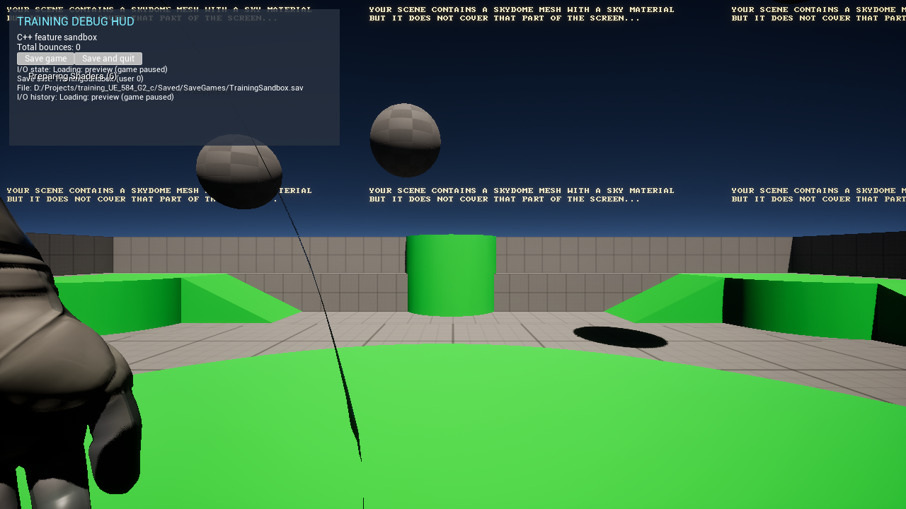

*Before the main menu existed, an offscreen test showed load progress and a restored total of 96 bounces.*

### First startup menu — task 18, November 7, 2026

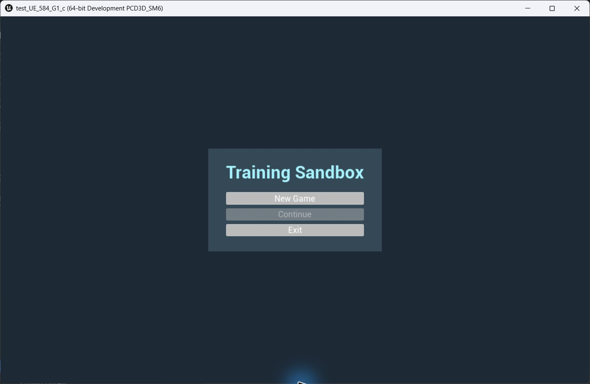

*The first startup menu offered New Game and Continue; the saved-total summary and Delete Save action came later.*

### Earlier defeat flow — before task 46, November 7, 2026

*The defeat screen offered Continue. The current defeat screen offers Retry and Exit.*

### Before Crazy balls branding — November 7, 2026

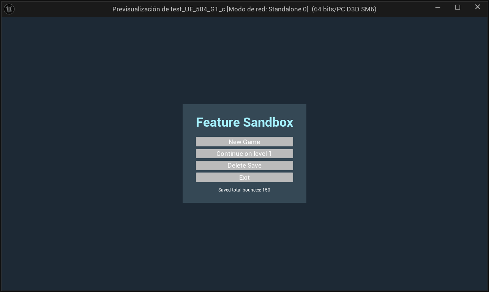

*The startup menu showed the previous title, saved level and bounce total, with New Game, Continue, Delete Save, and Exit.*

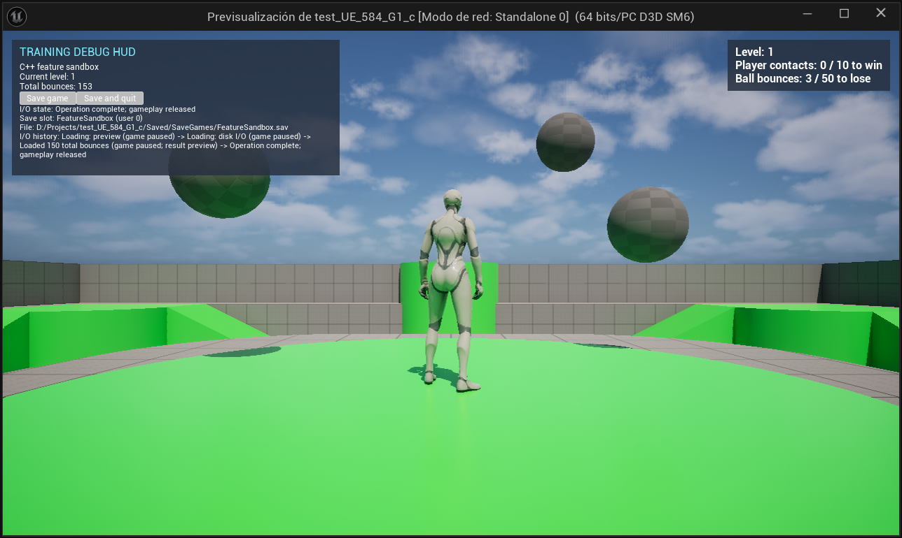

*Continue restored the saved total; gameplay showed the level, both objective counters, airborne balls, and the earlier debug HUD branding.*

Remaining work is tracked in [the backlog](AGENTS.MD#to-do).

## Validation note

November 8's focused MCP capture session exercised current menu, save/load, natural defeat, Retry, controlled victory, and next-level presentation. It did not run Gauntlet, packaging, performance profiling, standalone keyboard validation, or speed/contact tests. The latest recorded Gauntlet invocation still ended with Engine initialization failed before executing checks; this successful editor capture session does not establish that the runner is fixed.

Remaining work and the startup issue are tracked in [AGENTS.MD](AGENTS.MD#bugs).
