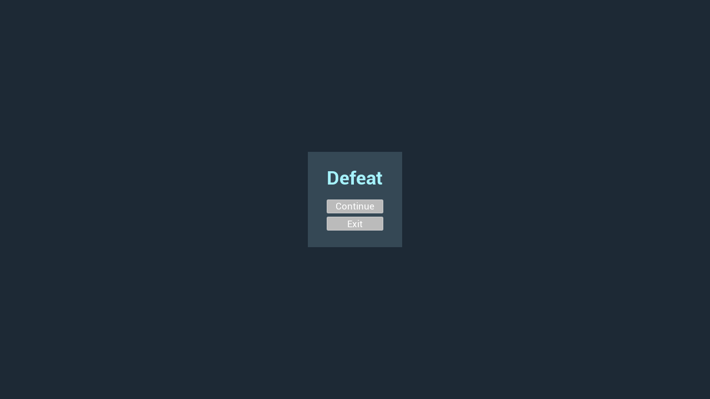

# Crazy balls changes

This index follows the completed task numbers in [AGENTS.MD](AGENTS.MD). Source links document implementation details that screenshots cannot establish. The latest verified runtime captures below were taken in the Unreal Editor on November 7, 2026.

## Latest verified game captures

*The startup menu offers New Game, Continue on level 1, Delete Save, and Exit, and displays the saved bounce total.*

*Continue restored the saved total; gameplay shows the current level, both objective counters, and airborne balls.*

These captures predate the current documentation and smoke-check updates; fresh editor captures were not available for this update.

## Completed tasks

| Task | Change | Source |
| --- | --- | --- |
| 1–6 | Spawn indexed balls in batches at random locations and trajectories; log lifecycle events. | [Game mode](Source/test_UE_584_G1_c/test_UE_584_G1_cGameMode.cpp) · [Spawner](Source/TestFeatures/Features_NonUE/FeatureBallSpawner.cpp) · [Ball](Source/TestFeatures/Features/Gameplay/FeatureBall.cpp) |
| 7–9 | Retire and reuse balls and cache their mesh component. Task 36 later changes the bounce limit. | [Ball](Source/TestFeatures/Features/Gameplay/FeatureBall.cpp) · [Pool](Source/TestFeatures/Features_NonUE/FeatureBallSpawner.cpp) |
| 10–11 | Track shared bounces and bridge ball events to game state. | [State](Source/TestFeatures/Features/Gameplay/FeatureGameState.cpp) · [Event controller](Source/TestFeatures/Features/Gameplay/FeatureGameStateController.cpp) |
| 12–13 | Build a native debug HUD and display the changing bounce total. | [Debug HUD](Source/TestFeatures/Features/UI/Archetypes/FeatureDebugHUD.cpp) · [Ball panel](Source/TestFeatures/Features/UI/Widgets/FeatureBallPanel.cpp) |
| 14–16 | Save and restore progress; pause during I/O with non-Shipping preview holds. | [Persistence subsystem](Source/TestFeatures/Features/GameWorkflow/FeatureSaveGameSubsystem.cpp) · [Save panel](Source/TestFeatures/Features/UI/Widgets/FeatureSaveGamePanel.cpp) |
| 17 | Put the feature systems in an independent runtime module. | [Module definition](Source/TestFeatures/TestFeatures.Build.cs) |
| 18–19 | Show the startup menu and start fresh after clearing the save. | [Menu views](Source/TestFeatures/Features/UI/Views/FeatureMenuViews.cpp) · [Game mode](Source/test_UE_584_G1_c/test_UE_584_G1_cGameMode.cpp) |
| 21–24 | Delete saves, disable Continue for an empty slot, exit, and pause with Escape. | [Menu](Source/TestFeatures/Features/UI/Archetypes/FeatureMainMenu.cpp) · [Game mode](Source/test_UE_584_G1_c/test_UE_584_G1_cGameMode.cpp) |
| 29–30 | Exit from the initial menu with Escape; display saved totals or an empty-slot message. | [Menu](Source/TestFeatures/Features/UI/Archetypes/FeatureMainMenu.cpp) |
| 31–32 | Provide `Feature.NewGame` and limit the debug HUD to non-Shipping builds. | [Console command](Source/test_UE_584_G1_c/FeatureConsoleCommands.cpp) · [Player controller](Source/test_UE_584_G1_c/test_UE_584_G1_cPlayerController.cpp) |
| 33 | Define eight Gauntlet checks across menu, session state, pool reuse, save serialization, loss-limit progression, player-contact replacement, and speed boosts. The latest run did not execute because the editor failed to initialize. | [Feature smoke tests](Source/TestFeatures/Features/Gameplay/FeatureSmokeTests.cpp) · [Player speed smoke test](Source/test_UE_584_G1_c/FeatureGameplaySmokeTests.cpp) · [Runner](Run-FeatureSmoke.ps1) |
| 34–35 | Package Win64 configurations and create a configurable collision enclosure. | [Packaging guide](README.md#package-for-win64) · [Level bounds](Source/TestFeatures/Features/Gameplay/FeatureLevelBounds.cpp) |
| 36 | Retire balls after five non-player bounces; player contact retires the ball and schedules a replacement. | [Ball](Source/TestFeatures/Features/Gameplay/FeatureBall.cpp) · [Session](Source/TestFeatures/Features/GameWorkflow/FeatureGameplaySession.cpp) |
| 37–38 | Record Victory or Defeat and show the corresponding result screen. | [Session](Source/TestFeatures/Features/GameWorkflow/FeatureGameplaySession.cpp) · [Menu views](Source/TestFeatures/Features/UI/Views/FeatureMenuViews.cpp) |
| 39 | Organize features into Gameplay, GameWorkflow, and UI. | [Feature guide](Source/TestFeatures/Features/README.md#folder-organization) |
| 40–42 | Persist session history, count player contacts, and end sessions at configurable limits. | [Save data](Source/TestFeatures/Features/GameWorkflow/FeatureSaveGame.h) · [Session](Source/TestFeatures/Features/GameWorkflow/FeatureGameplaySession.cpp) |
| 43–44 | Persist level progression and show the current session's objective counters. | [Game state](Source/TestFeatures/Features/Gameplay/FeatureGameState.cpp) · [Gameplay HUD](Source/TestFeatures/Features/UI/Archetypes/FeatureGameplayHUD.cpp) |
| 45 | Start with five active balls and prewarm a pool three times that size. | [Game mode defaults](Source/test_UE_584_G1_c/test_UE_584_G1_cGameMode.h) · [Session](Source/TestFeatures/Features/GameWorkflow/FeatureGameplaySession.cpp) |
| 46–47 | Offer Retry after defeat and save progress when either result is reached. | [Menu views](Source/TestFeatures/Features/UI/Views/FeatureMenuViews.cpp) · [Session](Source/TestFeatures/Features/GameWorkflow/FeatureGameplaySession.cpp) |
| 49–50 | Declare menu views in code and organize UI archetypes and panel widgets. | [Views](Source/TestFeatures/Features/UI/Views/FeatureMenuViews.cpp) · [Archetypes](Source/TestFeatures/Features/UI/Archetypes) · [Widgets](Source/TestFeatures/Features/UI/Widgets) |
| 51 | Document gameplay, UI, and game workflow connections with diagrams. | [System architecture](README.md#architecture) |
| 52 | Retire a player-contact ball and replace it through the pool. | [Session](Source/TestFeatures/Features/GameWorkflow/FeatureGameplaySession.cpp) · [Gauntlet check](Source/TestFeatures/Features/Gameplay/FeatureSmokeTests.cpp) |
| 53 | Configure the minimum loss limit; the level-one base target is 100 and the default floor is 50. | [Session limits](Source/TestFeatures/Features/GameWorkflow/FeatureGameplaySession.h) · [Gauntlet check](Source/TestFeatures/Features/Gameplay/FeatureSmokeTests.cpp) |
| 54 | Configure player speed and temporary contact boosts, with optional stacking. | [Character](Source/test_UE_584_G1_c/test_UE_584_G1_cCharacter.cpp) · [Gauntlet check](Source/test_UE_584_G1_c/FeatureGameplaySmokeTests.cpp) |
| 1001601 | Automate three-configuration Win64 packaging with a reusable archive ID. | [Build script](Build-Win64.ps1) · [Packaging guide](README.md#package-for-win64) |

## Game evolution

*Historical capture from November 7, 2026, before task 46: the defeat screen offered Continue. The current defeat screen offers Retry and Exit.*

The remaining work is tracked in [the backlog](AGENTS.MD#to-do).

## Validation note

The latest Gauntlet invocation ended with `Engine initialization failed (InitializationFailure, ExitCode=-1)` before an editor log was created, so it executed no checks. Compile validation also could not complete in this sandbox. See [the tracked bug](AGENTS.MD#bugs).
