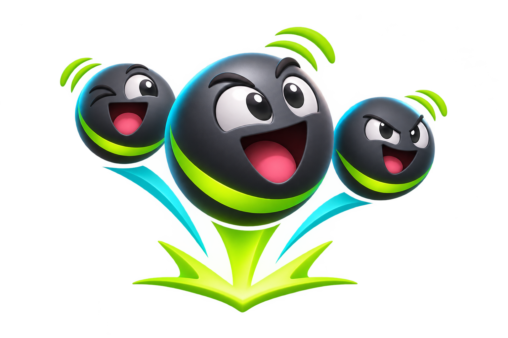
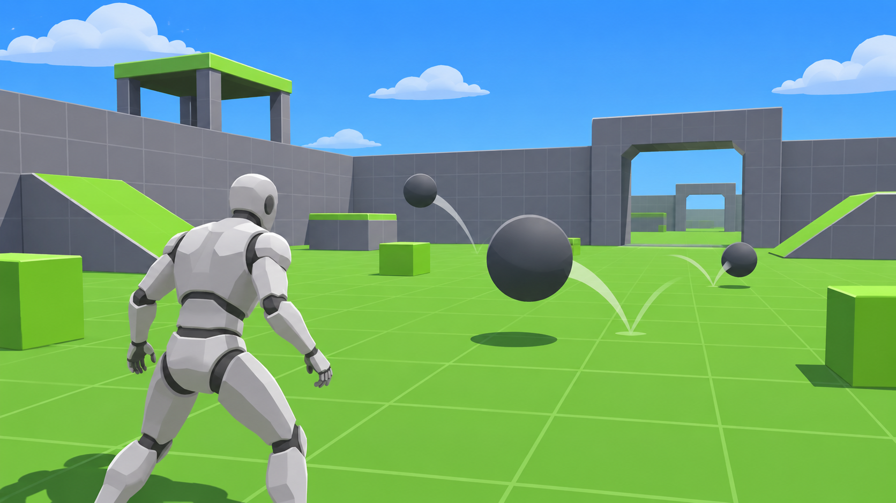
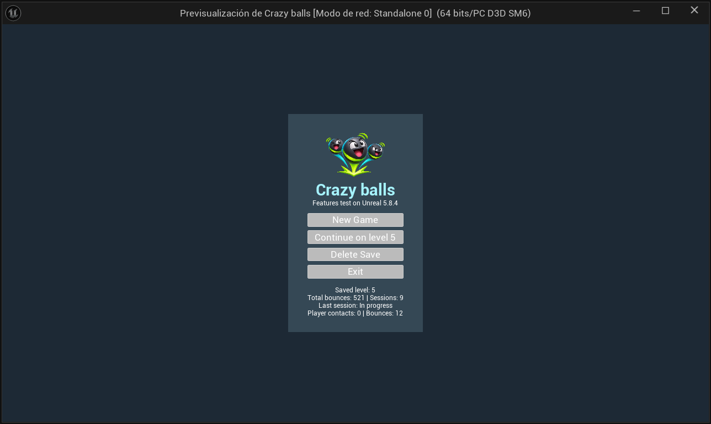
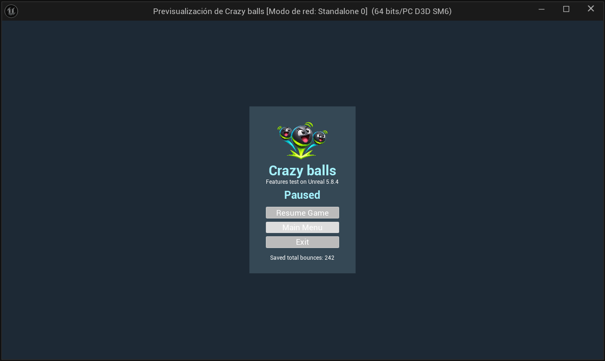
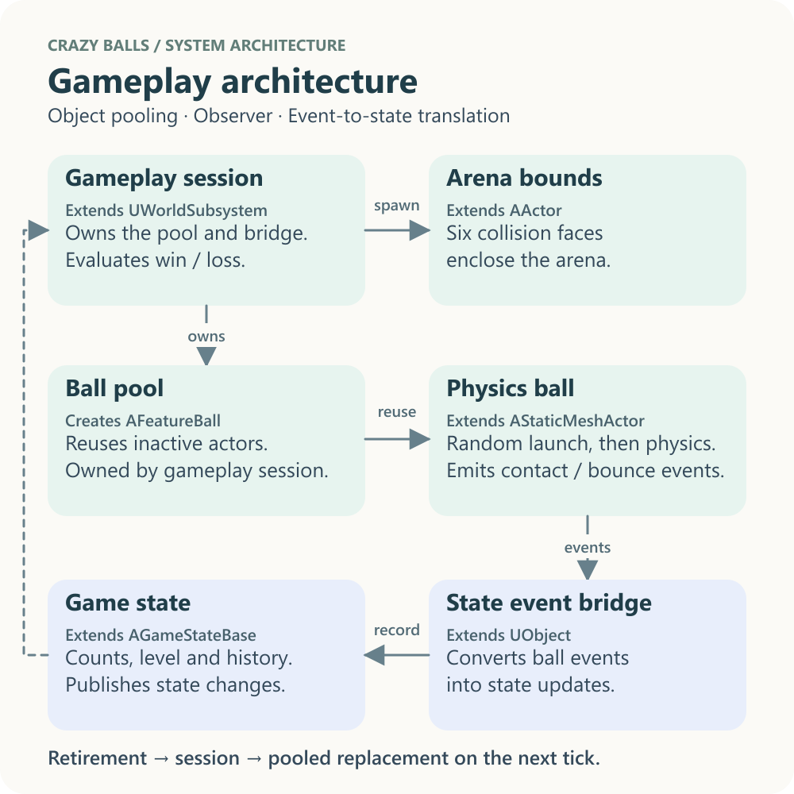
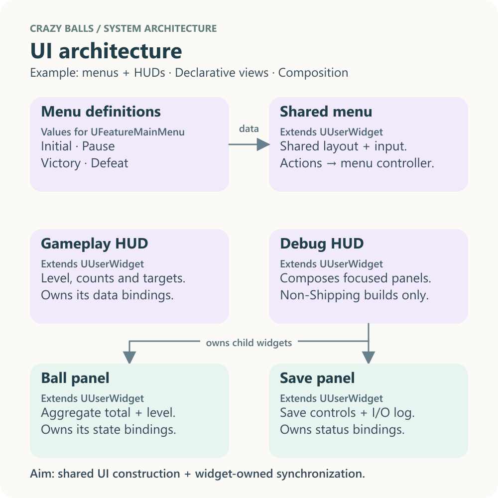
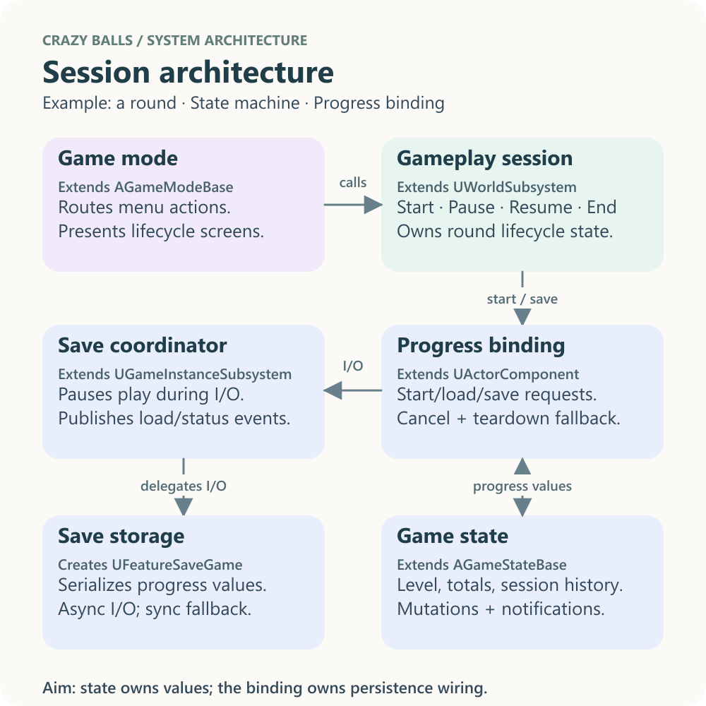
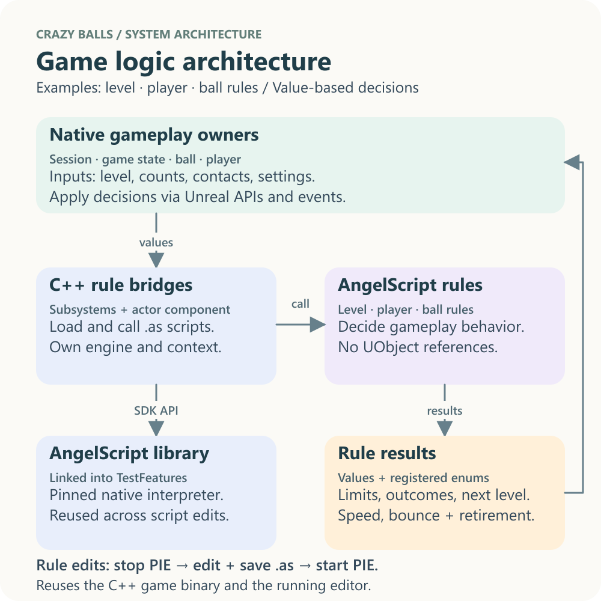
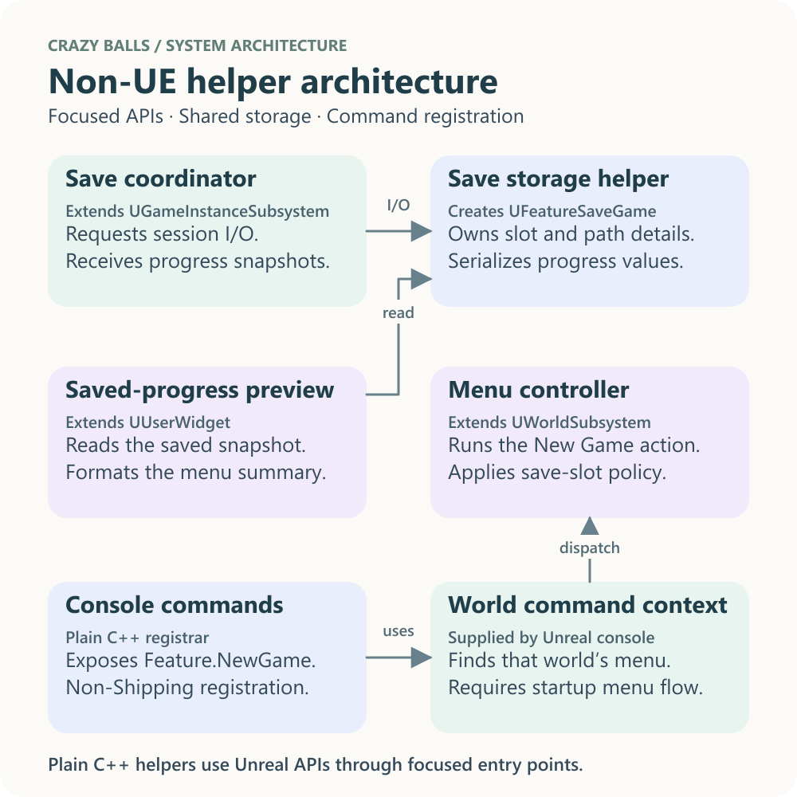

# Crazy balls

**Features test on Unreal 5.8.4**

### Latest release

[Download the latest release build](https://github.com/chaotive/test_UE_584_G1_c/releases/download/0.1/Build.zip) (`0.1`, Win64 Development, DebugGame, and Shipping).

## Game

Crazy balls is a third-person ball-contact game. Move around the arena and intercept the bouncing balls before too many of their other impacts are counted. Each round launches its configured number of balls from random positions in random directions.

*AI-generated illustration of the game's premise. This is concept art, not an in-game capture.*

### Jump into the arena

Choose **New Game** for a fresh game at the configured initial level (level 1 by default) or **Continue on level N** to play your saved level. Use **WASD** to move, the **mouse** to look, and **Space** to jump. Run into a ball to score a player contact: that ball is retired and another launches into the arena.

### Start fresh or pick up your count

The startup menu shows your saved level, total bounces, session count, and the latest session’s result and counts. The pause menu shows your last saved bounce total. On the startup menu, **Esc** exits. When the slot is empty, the menu shows **No saved game.** and disables **Continue**. Choose **Delete Save** on the startup menu to clear the slot; **New Game** also clears it before starting.

*November 8, 2026: the startup menu shows the logo, saved level, aggregate total, session count, and latest session details.*

### How to play

Each player-ball contact also doubles your configured base movement speed for five seconds by default. Another contact refreshes the boost, and pausing the game pauses its countdown. Optional stacking adds another bonus for each contact and resets the shared timer; with the default 2× bonus, consecutive contacts produce 2×, 3×, and 4× base speed until it expires.

Each session is a race between two counters:

1. **Make player contacts.** Move or jump into the balls. Each registered player-ball contact increases your win counter. The ball disappears and another is launched, giving you another chance to score.
2. **Keep an eye on other bounces.** When a ball hits the floor, a wall, or another ball with enough physical impulse to register a bounce, the loss counter rises. Player contacts are counted separately. Two balls hitting each other can each register a bounce.
3. **Reach the win target first.** Reaching the player-contact target ends the session in Victory. Reaching the non-player bounce limit ends it in Defeat. The top-right HUD shows the current level and both counts against their limits.

Each ball has its own lifetime: after its configured number of non-player bounces (five by default), it returns to the pool. A ball that touches the player is also retired immediately. In either case, a replacement is scheduled while the session is active. The [arena enclosure](docs/DEVELOPMENT.md#arena-collision-bounds) keeps the balls in the play area; its size and spawn settings are configurable.

#### Levels and results

By default, every new game begins at level 1; the initial level is configurable in the game mode. Winning advances the saved level by one; losing keeps the same level. Each new session resets its two objective counters, while the saved aggregate bounce total and session history continue across sessions.

The table shows configuration defaults; a level's game mode can override them. The gameplay HUD shows the active targets.

| Level | Player contacts to win | Non-player bounces to lose |
| --- | ---: | ---: |
| 1 | 10 | 100 |
| 2 | 11 | 99 |
| 3 | 12 | 98 |
| 50 | 59 | 51 |

The defaults follow `10 + (level - 1)` for the win target and `max(50, 100 - (level - 1))` for the loss limit. The game mode can change the base limits, per-level adjustments, and minimum loss limit. The default loss limit starts at 100 and decreases by one per level until it reaches 50. **Victory** pauses the game, records the result, advances the saved level, and saves progress through the [session result flow](docs/DEVELOPMENT.md#session-results). Choose **Continue** to start the next level. On **Defeat**, the game records and saves the result without advancing; choose **Retry** to start another session at that level, or **Exit** to save and quit.

#### Menus, pause, and saves

**New Game** deletes the current save and begins at the configured initial level with a fresh history. **Continue on level N** loads a readable save and starts its saved level. **Delete Save** removes the slot without starting a session; when there is no save, Continue is disabled and the menu displays **No saved game.** **Exit** closes the game, and **Esc** on the initial menu does the same.

During a session, **Esc** opens the pause menu. Choose **Resume Game** or press **Esc** again to continue the same session; **Main Menu** returns to the startup screen, and **Exit** saves and quits. Saving or loading pauses play during I/O. Non-Shipping builds also include a [debug HUD](docs/DEVELOPMENT.md#debug-hud-and-save-diagnostics) for inspecting live state and save operations.

*November 8, 2026: the pause menu, opened through the editor console, shows the shared logo, session controls, and last saved total.*

The save contains the current level, aggregate non-player bounce total, and a chronological session history with start times, counters, and results. The gameplay HUD's counters are for the current session; the debug HUD's total includes the saved history. A result screen requests a save automatically.

The renamed game uses a `CrazyBalls` save slot. Saves from the former `FeatureSandbox` slot are not loaded by this version.

Earlier milestones and their runtime captures are recorded in the [change history](CHANGES.md#game-evolution).

## Architecture

The flows below are small, purpose-built examples for this prototype. Each uses a concrete game feature to explore architectural benefits: clear ownership, localized dependencies, shared construction, and a single source of truth for rules and state. The patterns guide those boundaries; each implementation stays focused on its current use case and can grow when another use case needs it.

Each view highlights its own boundary: gameplay events, UI construction, session lifecycle, script iteration, or helper ownership. Repeated class names provide context; their detailed responsibilities stay in the relevant view. Solid arrows show calls or data flow; the dashed arrow shows state observation. Expand the class references for full names and base types. These are architecture illustrations, not runtime captures.

### Gameplay architecture

The ball cycle demonstrates Observer events and event-to-state translation. Balls report contacts and bounces; a focused bridge gives those events meaning as session statistics. The session observes the resulting score changes. This keeps physics behavior independent of shared state and UI. Pool ownership and reuse are detailed in the [non-UE helper view](#non-ue-helper-architecture).

Class reference

| Diagram role | Class | Base or primary consumer |
| --- | --- | --- |
| Gameplay session | `UFeatureGameplaySession` | Extends `UWorldSubsystem` |
| Arena bounds | `AFeatureLevelBounds` | Extends `AActor` |
| Ball pool | `FFeatureBallSpawner` | Creates `AFeatureBall` for `UFeatureGameplaySession` |
| Physics ball | `AFeatureBall` | Extends `AStaticMeshActor` |
| State event bridge | `UFeatureGameStateController` | Extends `UObject` |
| Game state | `AFeatureGameState` | Extends `AGameStateBase` |

Source: [session](Source/TestFeatures/Features/GameWorkflow/FeatureGameplaySession.cpp) · [pool](Source/TestFeatures/Features_NonUE/FeatureBallSpawner.cpp) · [ball](Source/TestFeatures/Features/Gameplay/FeatureBall.cpp) · [state bridge](Source/TestFeatures/Features/Gameplay/FeatureGameStateController.cpp).

### UI architecture

The four menu views demonstrate declarative differences over shared construction: common layout and behavior have one implementation, and each view supplies its heading and actions. The game mode manages menus; the player controller manages HUD lifetime. Widgets own their Observer bindings, so display changes stay within UI code and controllers do not need to know which state events update which labels.

The [saved-progress panel](Source/TestFeatures/Features/UI/Widgets/FeatureSavedProgressPanel.cpp) owns asynchronous preview loading, summary formatting, and deletion observation. The menu composes it and updates Continue/Delete Save from its saved-level and slot-availability events, with an initial read when the binding is attached.

Class reference

| Diagram role | Class | Base or primary consumer |
| --- | --- | --- |
| Menu definitions | `FFeatureMenuViews` | Creates `FFeatureMenuView` values for `UFeatureMainMenu` |
| Shared menu | `UFeatureMainMenu` | Extends `UUserWidget` |
| Saved-progress preview | `UFeatureSavedProgressPanel` | Extends `UUserWidget`; composed by the menu |
| Gameplay HUD | `UFeatureGameplayHUD` | Extends `UUserWidget` |
| Debug HUD | `UFeatureDebugHUD` | Extends `UUserWidget` |
| Ball panel | `UFeatureBallPanel` | Extends `UUserWidget` |
| Save panel | `UFeatureSaveGamePanel` | Extends `UUserWidget` |

Source: [views](Source/TestFeatures/Features/UI/Views/FeatureMenuViews.cpp) · [menu](Source/TestFeatures/Features/UI/Archetypes/FeatureMainMenu.cpp) · [HUDs](Source/TestFeatures/Features/UI/Archetypes/FeatureGameplayHUD.cpp) · [panels](Source/TestFeatures/Features/UI/Widgets/FeatureSaveGamePanel.cpp).

### Session and persistence architecture

A small enum-based state machine makes round transitions explicit. GameMode attaches a focused persistence component to the game state: the component connects restored snapshots, routes load/save requests, and owns cancellation and teardown saving. The state owns progress, mutations, and notifications without storage or save-subsystem dependencies. World and game-instance lifetimes remain separate, and the save subsystem publishes restored data and I/O status.

Class reference

| Diagram role | Class | Base or primary consumer |
| --- | --- | --- |
| Game mode | `Atest_UE_584_G1_cGameMode` | Extends `AGameModeBase` |
| Gameplay session | `UFeatureGameplaySession` | Extends `UWorldSubsystem` |
| Game state | `AFeatureGameState` | Extends `AGameStateBase` |
| Progress binding | `UFeatureProgressPersistence` | Extends `UActorComponent`; attached to game state by GameMode |
| Save coordinator | `UFeatureSaveGameSubsystem` | Extends `UGameInstanceSubsystem` |
| Save storage | `FFeatureSaveGameStorage` | Creates `UFeatureSaveGame` for `UFeatureSaveGameSubsystem` |
| Save snapshot | `UFeatureSaveGame` | Extends `USaveGame` |

Source: [game mode](Source/test_UE_584_G1_c/test_UE_584_G1_cGameMode.cpp) · [progress binding](Source/TestFeatures/Features/GameWorkflow/FeatureProgressPersistence.cpp) · [save coordinator](Source/TestFeatures/Features/GameWorkflow/FeatureSaveGameSubsystem.cpp) · [storage](Source/TestFeatures/Features_NonUE/FeatureSaveGameStorage.cpp) · [snapshot](Source/TestFeatures/Features/GameWorkflow/FeatureSaveGame.h).

### Game logic architecture

AngelScript lets simple, code-based gameplay decisions change without rebuilding C++. The current examples cover level limits, session outcomes and progression, player speed bonuses, and ball lifetime. Focused bridges pass values to the scripts and apply their results through Unreal APIs. C++ owns configuration, authoritative state, events, timers, physics, pooling, and persistence; registered native enums keep result and action definitions shared. The [game-logic guide](Source/TestFeatures/Features_GameLogic/README.GAMELOGIC.md) maps each script to its bridge and consumers.

Level and ball rules load once per world; player rules load when a spawned character's component is configured. Stop PIE, edit and save the relevant `.as` file, then start PIE to load the latest rules using the existing game binary and editor. Live hot reload is secondary; changing the native interface still requires a C++ build. See [AngelScript development](docs/DEVELOPMENT.md#angelscript-rules) for the workflow and packaging details.

Class and binding reference

| Responsibility | Class or value | Base or primary consumer |
| --- | --- | --- |
| Gameplay session | `UFeatureGameplaySession` | Extends `UWorldSubsystem`; supplies level and configuration values |
| C++ rules host | `UFeatureLevelRules` | Extends `UWorldSubsystem`; owns an `FFeatureScriptRuntime` for level rules |
| AngelScript rules | `PlayerContactsToWin` / `SessionBouncesToLose` in `FeatureLevelRules.as` | Stateless functions called by `UFeatureLevelRules` |
| Session and progression decisions | `SessionOutcome` / `NextLevel` in `FeatureLevelRules.as` | Applied by the gameplay session and game state |
| Ball rules bridge | `UFeatureBallRules` | Extends `UWorldSubsystem`; translates collision facts and calls `FeatureBallRules.as` |
| Player-character bridge | `UFeaturePlayerRules` | Extends `UActorComponent`; calls `FeaturePlayerRules.as` and owns native movement/timer integration |
| Runtime implementation | `FFeatureScriptRuntime` | Owns an independent engine and context for each focused bridge |
| AngelScript library | `FeatureAngelScriptRuntime` external module | Links the pinned Win64 static library into `TestFeatures` |
| Calculated limits | `int32` return values | Consumed by session limit checks and the gameplay HUD |

Source: [AS rules](Source/TestFeatures/Features_GameLogic/FeatureLevelRules.as) · [C++ host](Source/TestFeatures/Features_GameLogic/FeatureLevelRules.cpp) · [session consumers](Source/TestFeatures/Features/GameWorkflow/FeatureGameplaySession.cpp) · [dependency manifest](Source/ThirdParty/FeatureAngelScriptRuntime/Dependency.json). See the [library versioning guide](Source/ThirdParty/FeatureAngelScriptRuntime/README.ANGELSCRIPT.md) for versioning and updates.

### Non-UE helper architecture

This view focuses on ownership and narrow helper APIs. The session owns its pool by value; weak references observe world-owned actors without retaining them. Storage and HUD factory helpers contain the engine API details needed by their callers. These are plain C++ classes using Unreal types, with no UObject lifetime of their own. Event scoring belongs to the gameplay view, rendered composition to the UI view, and pause/result coordination to the session view.

Class and ownership reference

| Diagram role | Class | Base or primary consumer |
| --- | --- | --- |
| Gameplay session | `UFeatureGameplaySession` | Extends `UWorldSubsystem`; owns the pool helper by value |
| Ball pool helper | `FFeatureBallSpawner` | Creates `AFeatureBall` for `UFeatureGameplaySession`; world owns actors |
| Save coordinator | `UFeatureSaveGameSubsystem` | Extends `UGameInstanceSubsystem`; coordinates persistence |
| Save storage helper | `FFeatureSaveGameStorage` | Creates `UFeatureSaveGame` snapshots for the save coordinator; also serves menu previews |
| Player controller | `Atest_UE_584_G1_cPlayerController` | Extends `APlayerController`; retains and removes HUD widgets |
| Debug HUD factory | `FFeatureDebugHUDSpawner` | Creates `UFeatureDebugHUD` for the player controller in non-Shipping builds |

Source: [ball pool](Source/TestFeatures/Features_NonUE/FeatureBallSpawner.cpp) · [save storage](Source/TestFeatures/Features_NonUE/FeatureSaveGameStorage.cpp) · [HUD factory](Source/TestFeatures/Features_NonUE/FeatureDebugHUDSpawner.cpp) · [player controller](Source/test_UE_584_G1_c/test_UE_584_G1_cPlayerController.cpp).

The `TestFeatures` runtime module houses gameplay, UI, and persistence. Unreal and Blueprint provide the framework and supplementary assets; AngelScript implements level, player, and ball rules through an embedded standalone runtime.

Within `TestFeatures/Features`, `Gameplay` contains balls, bounds, and bounce state. `GameWorkflow` contains session and persistence code. `UI` contains menus and HUD panels. AngelScript rules and their C++ bridges live together in the sibling `Features_GameLogic` folder. Plain C++ spawning, storage, and HUD factory helpers live in `Features_NonUE`.

## Development

### Run and test

Open the project in Unreal Engine 5.8.4, build the Development Editor target, open the Third Person map, and press **Play**. The [build-and-run instructions](docs/DEVELOPMENT.md#build-and-run) cover setup and the development console command. After building, use [Gauntlet smoke checks](docs/DEVELOPMENT.md#smoke-checks) to check selected features; that guide explains their scope and report location.

### Make changes

Edit native systems in [Source/TestFeatures](Source/TestFeatures) and rebuild the editor target for C++ changes. The [feature walkthrough](Source/TestFeatures/Features/README.FEATURES.md) explains the code and lifecycle; the [helper guide](Source/TestFeatures/Features_NonUE/README.NON_UE.md) covers plain C++ ownership boundaries. For script-only logic changes, follow the [game-logic workflow](Source/TestFeatures/Features_GameLogic/README.GAMELOGIC.md#change-a-rule): stop PIE, save the rule edit, and start PIE again without rebuilding C++. Native binding changes still need a C++ build.

Use [game-mode configuration](docs/DEVELOPMENT.md#game-mode-configuration) for spawning and movement settings, and [arena collision bounds](docs/DEVELOPMENT.md#arena-collision-bounds) to resize the play area. Use [session-result details](docs/DEVELOPMENT.md#session-results) when changing win, loss, or retry behavior, and the [debug HUD and diagnostics](docs/DEVELOPMENT.md#debug-hud-and-save-diagnostics) to inspect state and persistence. The [performance review](docs/PERFORMANCE_IDEAS.md) identifies current investigation ideas, their source evidence, and measurements needed before optimizing.

### Project tools and delivery

Use [Win64 packaging](docs/DEVELOPMENT.md#package-for-win64) to produce Development, DebugGame, and Shipping archives. For authorized editor automation, see [Unreal Editor MCP setup](docs/DEVELOPMENT.md#local-unreal-editor-mcp). The [development guide's grouped topic index](docs/DEVELOPMENT.md#topic-index) brings these workflows together; [AGENTS.MD](AGENTS.MD) defines project and agent rules.
