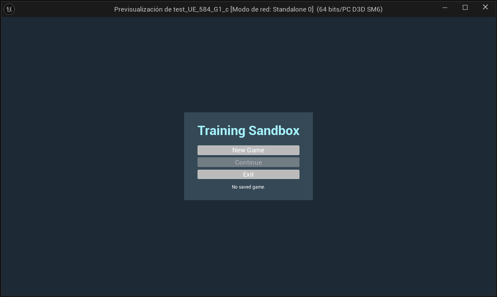
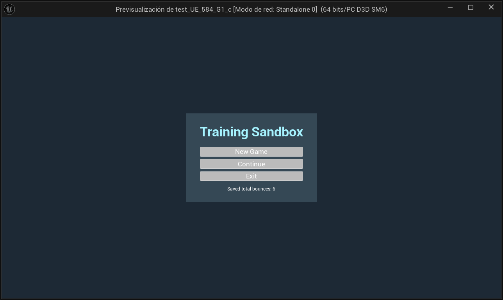
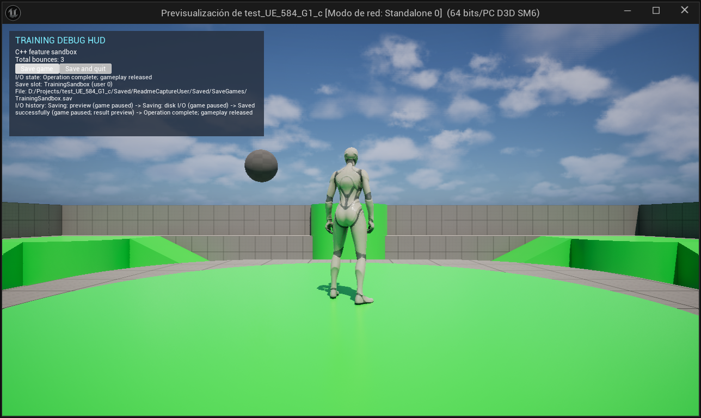
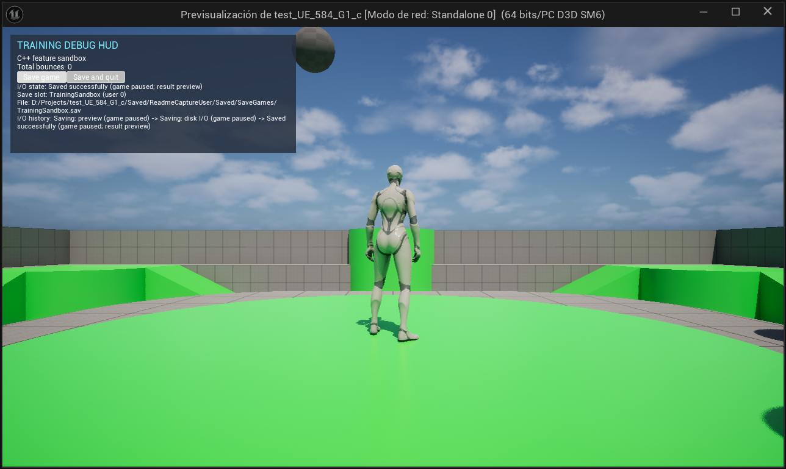
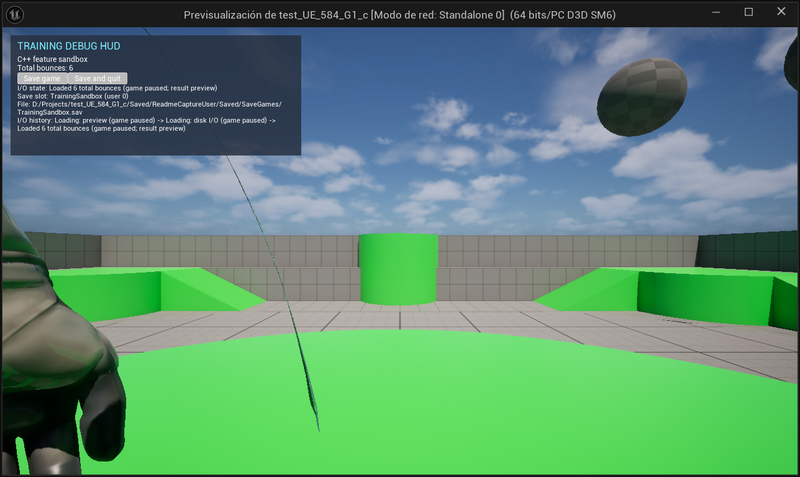

# Feature Sandbox

Step into a third-person training arena and watch the first volley scatter. Run, jump, and follow the ricochets as the live counter ticks up. Every round starts with a fresh mix of launch positions and trajectories, and you can save your bounce total to pick up where you left off.

## Jump into the arena

Feature Sandbox is a playable PC prototype built in Unreal Engine 5.8.

1. Open `test_UE_584_G1_c.uproject` in Unreal Engine 5.8 and build the editor target.
2. Open the Third Person map and press **Play**.
3. Choose **New Game** to start at zero, **Continue** to restore the local save, or **Exit** to close the standalone game. Continue is disabled when the save slot is empty.
4. Use **WASD** to move, the **mouse** to look, and **Space** to jump.

In a non-Shipping build, run `Feature.NewGame` from the console while the startup menu is open to enter the arena immediately with a zero bounce total. In Play In Editor, you can enter it in the Output Log command field. [Console command implementation](Source/test_UE_584_G1_c/FeatureConsoleCommands.cpp)

## Start fresh or pick up your count

The startup and pause menus show your last saved bounce total. If you're starting fresh, the menu shows **No saved game.** During gameplay, press **Esc** to pause. Press it again or choose **Resume Game** to return to the arena.

*Unreal Editor play session with an empty slot. The menu shows “No saved game.” and disables Continue. This capture predates the rename to Feature Sandbox.*

*After restarting the play session, the menu shows six saved bounces and enables Continue. This capture predates the rename to Feature Sandbox.*

## Follow the ricochets

The first batch of training balls launches as you enter. Keep an eye on the HUD to see the shared count rise with every bounce. Each ball disappears from the arena after its second bounce.

*A training ball is airborne beside the player character. The debug HUD shows three total bounces.*

## Take your total with you

Use **Save game** to keep playing after a save, or **Save and quit** to leave after the write succeeds. When you come back, **Continue** restores your bounce total before the arena resumes. The HUD shows what the game is doing while it saves or loads.

*The save result appears in the debug HUD while the arena is paused. The history records the preview, disk I/O, and successful write.*

*Continue restores six total bounces. The HUD shows the restored value during the paused load result preview.*

Feature Sandbox uses the `FeatureSandbox` save slot. Continue is available once that slot has a save.

## Under the hood

- **Game flow.** The game mode owns startup, gameplay, pause, victory, and defeat. The startup title comes from `ProjectName` in `Config/DefaultGame.ini`. A future gameplay objective can call `FinishSession` to show a result screen. [Game flow states](Source/TestFeatures/Features/FeatureGameFlow.h)
- **Physics and state.** The C++ spawner launches single balls or batches inside configurable bounds and reuses pooled actors after their second bounce. Balls publish bounce events, a state controller updates the shared total, and the debug HUD observes it. The Unreal log records lifecycle events, launches, bounces, and pool returns.
- **Persistence.** The menu reads the save preview asynchronously. Session saves and loads pause gameplay and show one-second previews before disk I/O and after the result. The debug HUD reports the slot, file path, and operation history.
- **Module boundaries.** The `TestFeatures` runtime module houses the C++ gameplay, UI, and persistence code. The project uses standard Unreal assets and has no third-party plugin dependencies. Blueprint supports supplementary logic, and an AngelScript feature is planned.

- [Gameplay systems and HUD](Source/TestFeatures/Features/README.md)
- [Runtime helpers](Source/TestFeatures/Features_NonUE/README.md)
- [Project objectives and technical requirements](AGENTS.MD)

### Local Unreal Editor MCP

Open `test_UE_584_G1_c.uproject` normally. The project enables Epic's built-in MCP and toolset plugins for editor targets and starts the local server automatically. To turn off automatic startup for your local editor, clear **Auto Start Server** under **Edit → Editor Preferences → Model Context Protocol**.

The trusted project's `.codex/config.toml` points Codex at `http://127.0.0.1:8000/mcp`. Wait for the editor to finish loading and the local server to respond. If the current chat does not expose the Unreal tools, start a new Codex chat in this project with the editor still open.

## How the game evolved

- **Before the main menu.** The debug HUD already showed load progress and restored bounce totals. The November 1, 2026 capture shows an offscreen test that restored 96 bounces. [Historical loading HUD](docs/images/in-game-loading-hud.png)
- **First startup menu (Task 18).** New Game and Continue gave players separate ways into the arena. The menu disabled Continue when the slot was empty. The saved-total summary shown above came later. [Historical startup menu](docs/images/task-18-main-menu.jpg)
