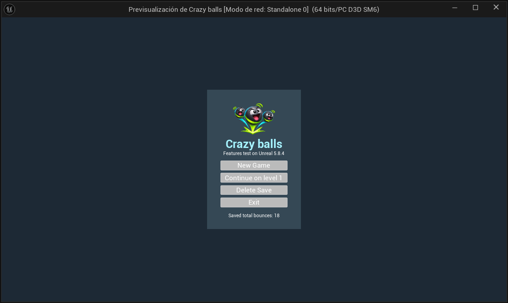
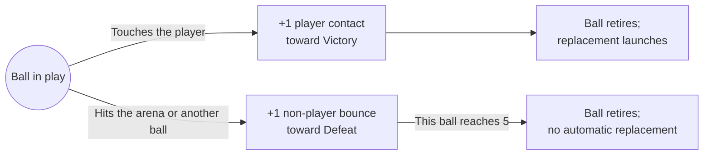
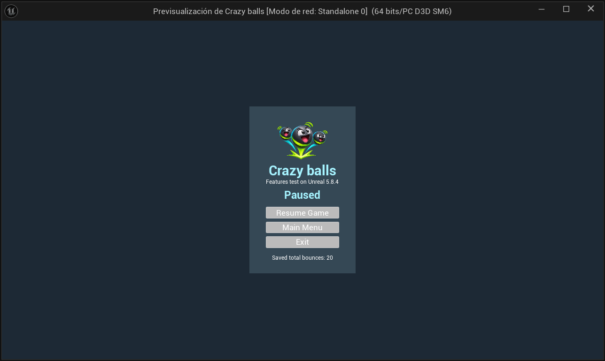
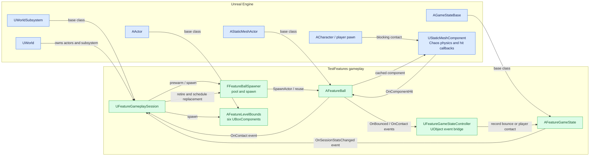
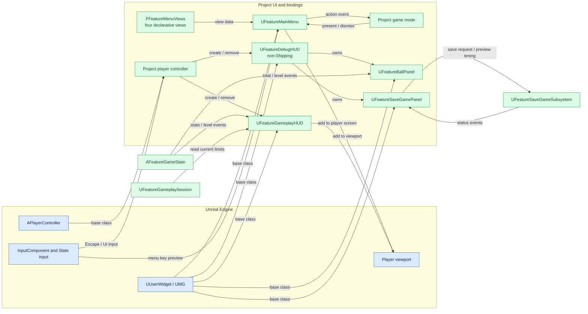
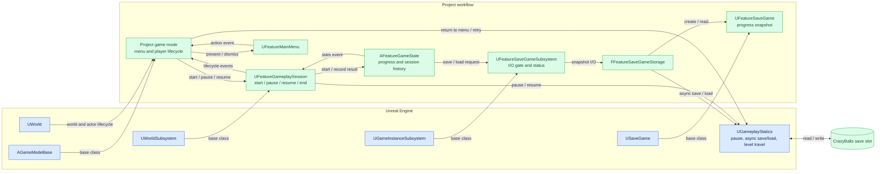
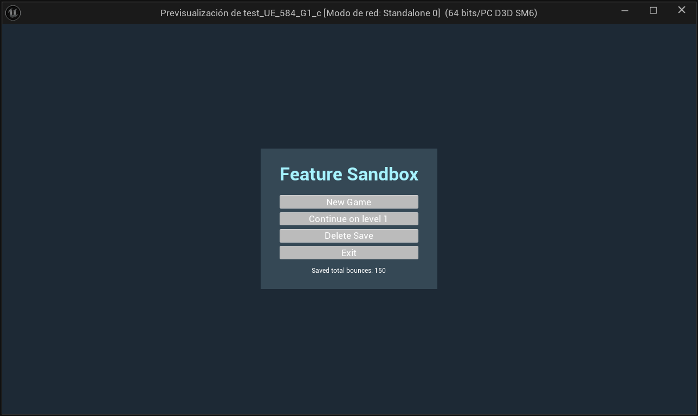
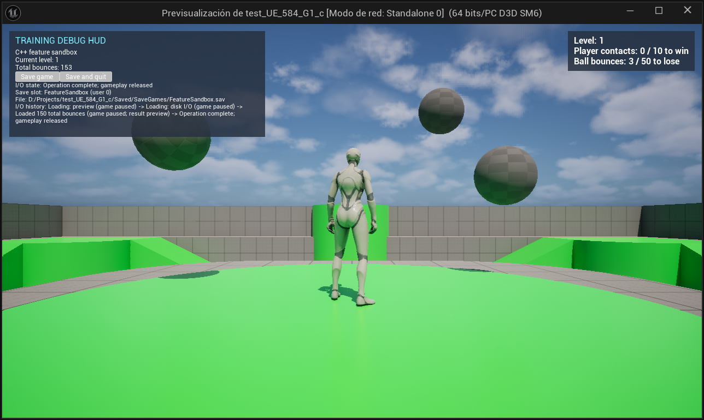
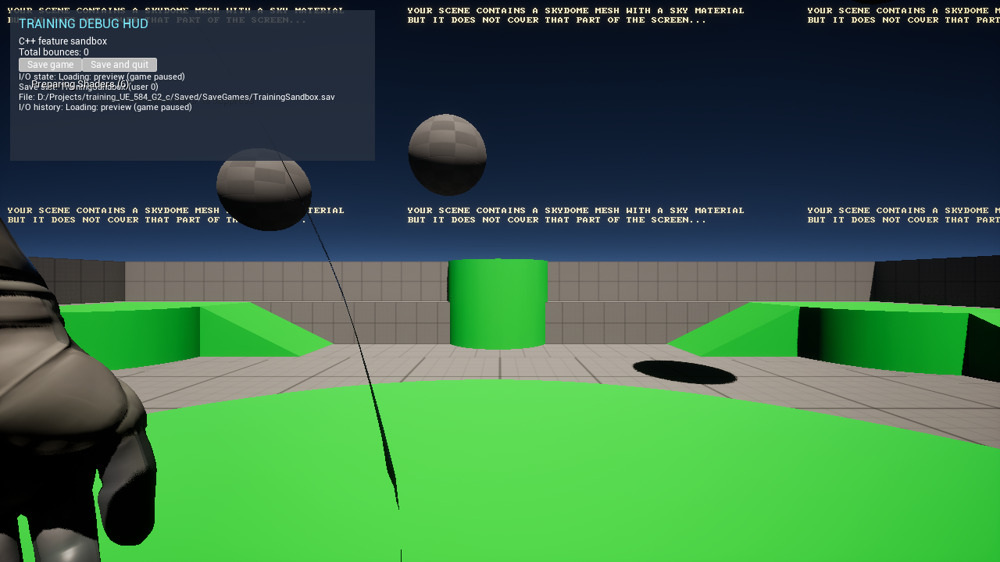
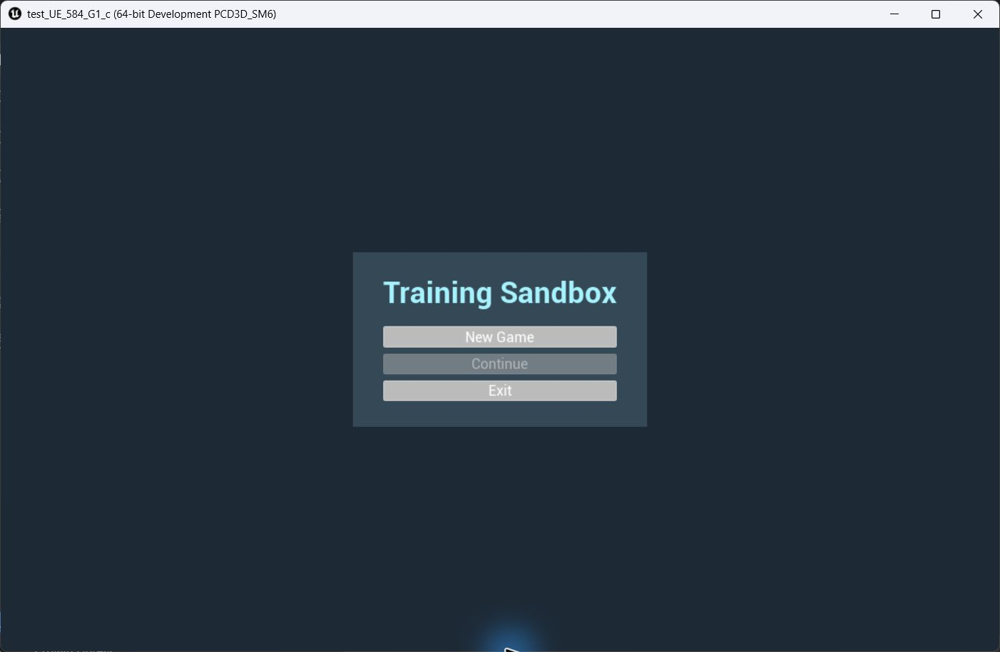

# Crazy balls

**Features test on Unreal 5.8.4**

Crazy balls is a third-person ball-contact game. Move around the arena and intercept the bouncing balls before too many of their other impacts are counted. Each round starts with five balls launched from random positions in random directions.


*AI-generated illustration of the game's premise. This is concept art, not an in-game capture.*

## Jump into the arena

Choose **New Game** for a fresh level-one game or **Continue on level N** to play your saved level. Use **WASD** to move, the **mouse** to look, and **Space** to jump. Run into a ball to score a player contact: that ball is retired and another launches into the arena.

## Start fresh or pick up your count

The startup and pause menus show your last saved bounce total. On the startup menu, **Esc** exits. When the slot is empty, the menu shows **No saved game.** and disables **Continue**. Choose **Delete Save** on the startup menu to clear the slot; **New Game** also clears it before starting.



*November 7, 2026: the startup menu shows the logo, subtitle, saved level, and bounce total.*

## How to play

Each session is a race between two counters:

1. **Make player contacts.** Move or jump into the balls. Each registered player-ball contact increases your win counter. The ball disappears and another is launched, giving you another chance to score.
2. **Keep an eye on other bounces.** When a ball hits the floor, a wall, or another ball with enough physical impulse to register a bounce, the loss counter rises. Player contacts are counted separately. Two balls hitting each other can each register a bounce.
3. **Reach the win target first.** Reaching the player-contact target ends the session in Victory. Reaching the non-player bounce limit ends it in Defeat. The top-right HUD shows the current level and both counts against their limits.

Each ball also has its own lifetime: after five non-player bounces it disappears and returns to the pool. A ball that expires this way is **not** automatically replaced. A ball that touches the player is retired immediately and a replacement is scheduled while the session is active. This means the number of balls still in play can fall as the round continues.



### Levels and results

Every new game begins at level 1. Winning advances the saved level by one; losing keeps the same level. Each new session resets its two objective counters, while the saved aggregate bounce total and session history continue across sessions.

| Level | Player contacts to win | Non-player bounces to lose |
| --- | ---: | ---: |
| 1 | 10 | 50 |
| 2 | 11 | 49 |
| 3 | 12 | 48 |
| 50 | 59 | 1 |

The defaults follow `10 + (level - 1)` for the win target and `max(1, 50 - (level - 1))` for the loss limit. On **Victory**, the game pauses, records the result, advances the saved level, and requests a save. Choose **Continue** to return to the initial menu, then **Continue on level N** to play the new level. On **Defeat**, the game records and saves the result without advancing; choose **Retry** to start another session at that level, or **Exit** to save and quit.

### Menus, pause, and saves

**New Game** deletes the current save and begins level 1 with a fresh history. **Continue on level N** loads a readable save and starts its saved level. **Delete Save** removes the slot without starting a session; when there is no save, Continue is disabled and the menu displays **No saved game.** **Exit** closes the game, and **Esc** on the initial menu does the same.

During a session, **Esc** opens the pause menu. Choose **Resume Game** or press **Esc** again to continue the same session; **Main Menu** returns to the startup screen, and **Exit** saves and quits. Saving or loading pauses play during I/O. In non-Shipping builds, the debug panel also offers **Save game** and **Save and quit** and shows save diagnostics.



*November 7, 2026: the pause menu, opened through the editor console, shows the shared logo and session controls.*

The save contains the current level, aggregate non-player bounce total, and a chronological session history with start times, counters, and results. The gameplay HUD's counters are for the current session; the debug HUD's total includes the saved history. A result screen requests a save automatically.

The renamed game uses a `CrazyBalls` save slot. Saves from the former `FeatureSandbox` slot are not loaded by this version.

## Development

### Build and run

1. Open `test_UE_584_G1_c.uproject` in Unreal Engine 5.8 and build the editor target.
2. Open the Third Person map and press **Play**.
3. In a non-Shipping build, enter `Feature.NewGame` in the console at the startup menu to start immediately. In Play In Editor, use the Output Log command field. [Console command implementation](Source/test_UE_584_G1_c/FeatureConsoleCommands.cpp)

### Smoke checks

After building the Development Editor target, run `./Run-FeatureSmoke.ps1` in PowerShell. It invokes Unreal's Gauntlet editor automation runner for the `Feature.Smoke` tests, which check menu definitions, session-state counters and outcomes, ball-pool reuse, and save serialization. Reports and logs are stored under `Intermediate/FeatureSmoke`. These checks do not replace a playthrough or exercise the rendered UI.

### Package for Win64

[Build-Win64.ps1](Build-Win64.ps1) generates project files, then packages Development, DebugGame, and Shipping together. It discovers the project's Unreal Engine version through the Windows installation registry, falling back to `D:\Program Files\Epic Games\UE_<version>`. Project and archive paths are relative to the script. Project-file generation must succeed before packaging starts.

```powershell
.\Build-Win64.ps1
```

The default archive ID is `Dev`, so repeated calls reuse `Builds\Dev`. After packaging, the script copies the latest AutomationTool `Log.txt` for this project's current run to `Build.log` in that archive, including failed packaging runs that produced a log. Reusing an ID replaces its attached log. Supply an ID to use a different archive directory:

```powershell
.\Build-Win64.ps1 -Id '1'
```

DebugGame supports debugging project C++. Each archive contains a `Windows` directory with configuration-specific launchers. Keep the staged files together when launching any of the three builds.

The asset manager registers the `GameFeatureData` cook rule required by the engine's Game Features subsystem. [Project settings](Config/DefaultGame.ini)

### Arena collision bounds

Gameplay creates one `AFeatureLevelBounds` actor with six invisible collision faces. The initial interior spans 120 × 120 × 60 meters around a center 20 meters above the world origin. Edit `Feature Bounds` in the game-mode defaults to change its center and half-size. The faces block physics balls. Balls return to the pool after five non-player bounces or player contact.

`UFeatureGameplaySession` is a world subsystem that organizes `OnGameplaySessionStart`, `OnGameplaySessionResume`, `OnGameplaySessionPaused`, and `OnGameplaySessionEnded`. Its start workflow creates the enclosure before the initial ball volley. The game mode observes lifecycle events to spawn the player and present screens. Other features can access the session through `World.GetSubsystem<UFeatureGameplaySession>()` and subscribe to its lifecycle events.

### Session results

A victory or defeat pauses gameplay, saves the session, and presents the matching fullscreen result. **Continue** returns to the startup menu after victory. **Retry** reloads the arena and starts a new session after defeat.

### Debug HUD and save diagnostics

The non-Shipping debug HUD shows the live bounce count, the save slot and file path, and the I/O history. Its **Save game** button writes a snapshot while keeping the session open. **Save and quit** exits after a successful write.

Shipping builds skip the debug previews and keep gameplay paused until disk I/O finishes.

### Architecture

The diagrams below show the actual project types and their Unreal Engine integration. **Extends** means C++ inheritance; **event** means a native delegate broadcast. Other arrows are calls, ownership, or data flow as labeled. Blue nodes are Unreal Engine systems; green nodes are project systems.

#### Gameplay systems



The spawner is a plain C++ value owned by the world subsystem; actors remain world-owned and are observed through weak pointers. Ball callbacks publish events rather than directly updating the game state. The session listens to state changes to evaluate limits and handles replacement after a player contact. See [ball](Source/TestFeatures/Features/Gameplay/FeatureBall.cpp), [spawner](Source/TestFeatures/Features_NonUE/FeatureBallSpawner.cpp), [state controller](Source/TestFeatures/Features/Gameplay/FeatureGameStateController.cpp), and [session](Source/TestFeatures/Features/GameWorkflow/FeatureGameplaySession.cpp).

#### UI systems



The menu and HUDs derive from `UUserWidget` and build their widget trees in C++. All menu views share the Crazy balls logo and the title and subtitle from project settings. The logo is loaded from `Content/FeatureBrand` and included in packaged builds as UFS content. The player controller creates and removes HUDs; each widget owns its own state subscriptions and initial synchronization. The debug save panel observes persistence status and drives its preview timers. See [menu](Source/TestFeatures/Features/UI/Archetypes/FeatureMainMenu.cpp), [gameplay HUD](Source/TestFeatures/Features/UI/Archetypes/FeatureGameplayHUD.cpp), and [save panel](Source/TestFeatures/Features/UI/Widgets/FeatureSaveGamePanel.cpp).

#### Game workflow and persistence



`AGameModeBase` presents the current flow and responds to session events. The world subsystem starts and ends sessions; the game-instance subsystem serializes save/load requests and keeps the world paused during I/O. `USaveGame` holds the level, aggregate count, and chronological session records. See [game mode](Source/test_UE_584_G1_c/test_UE_584_G1_cGameMode.cpp), [save subsystem](Source/TestFeatures/Features/GameWorkflow/FeatureSaveGameSubsystem.cpp), and [save data](Source/TestFeatures/Features/GameWorkflow/FeatureSaveGame.h).

The `TestFeatures` runtime module houses gameplay, UI, and persistence. Unreal and Blueprint provide the framework and supplementary assets; AngelScript remains a project goal.

Within `TestFeatures/Features`, `Gameplay` contains balls, bounds, and bounce state. `GameWorkflow` contains session and persistence code. `UI` contains menus and HUD panels. Plain C++ spawning and storage helpers live in the sibling `Features_NonUE` folder.

- [Gameplay systems and HUD](Source/TestFeatures/Features/README.md)
- [Gameplay, UI, and workflow diagrams](docs/feature-flows.md)
- [Runtime helpers](Source/TestFeatures/Features_NonUE/README.md)
- [Project objectives and technical requirements](AGENTS.MD)
- [Completed tasks and capture index](CHANGES.md)

### Local Unreal Editor MCP

For explicitly requested editor work, open `test_UE_584_G1_c.uproject` normally. The project enables Epic's built-in MCP and toolset plugins for editor targets and starts the local server automatically. To turn off automatic startup for your local editor, clear **Auto Start Server** under **Edit → Editor Preferences → Model Context Protocol**.

The trusted project's `.codex/config.toml` points Codex at `http://127.0.0.1:8000/mcp`. If the endpoint is unavailable and Unreal Editor is closed, open the project and wait for the editor to finish loading and the local server to respond. If the current chat does not expose the Unreal tools once the server responds, start a new Codex chat in this project with the editor still open.

### Game evolution



*November 7, 2026, before the Crazy balls rename: the startup menu showed the previous title and saved total.*



*November 7, 2026, before the rename: gameplay showed level-one objective counters and the earlier debug HUD branding.*



*November 1, 2026, before the main menu: an offscreen test showed load progress and a restored total of 96 bounces.*



*Task 18, November 7, 2026: the first startup menu offered New Game and Continue; the saved-total summary and Delete Save action came later.*
