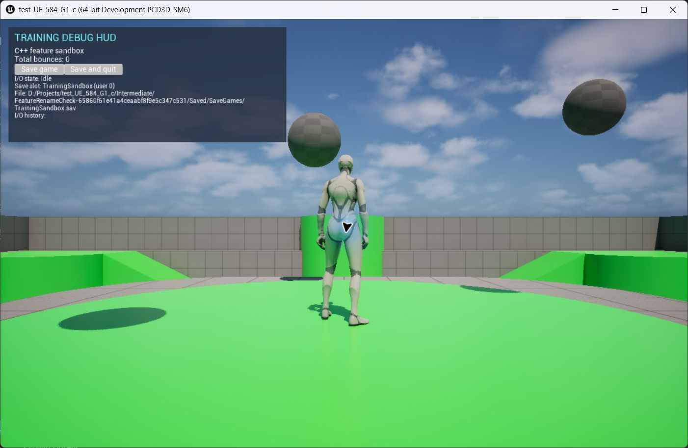
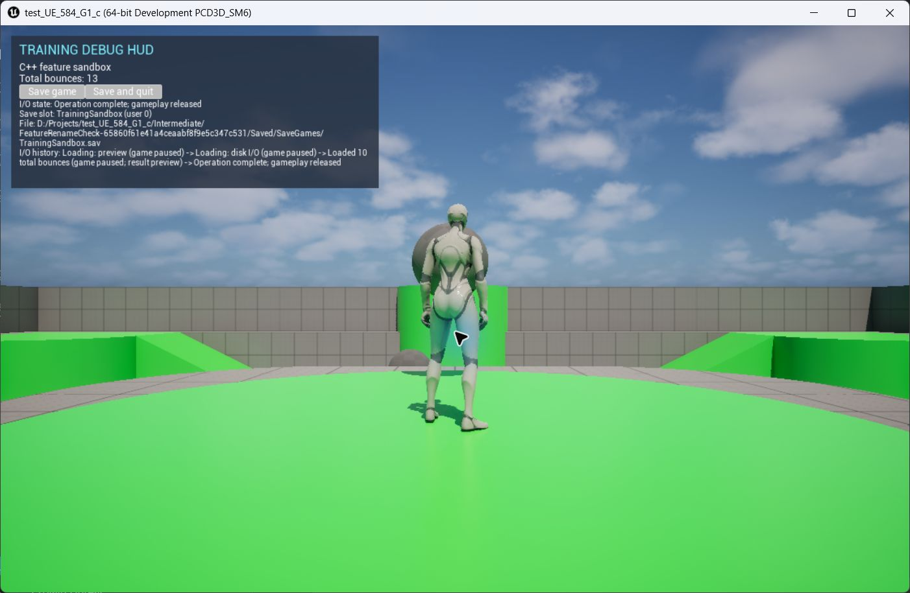

# test_UE_584_G1_c

A third-person mini-game prototype for PC, played with mouse and keyboard. The target is a complete, short play session. Players start from a main menu, enter gameplay with a clear objective and an in-game HUD, and reach a defined end state.

## Local Unreal Editor MCP

Open `test_UE_584_G1_c.uproject` normally. The project enables Epic's built-in MCP and toolset plugins for editor targets and starts the local server automatically. To turn off automatic startup for your local editor, clear **Auto Start Server** under **Edit → Editor Preferences → Model Context Protocol**.

The trusted project's `.codex/config.toml` points Codex at `http://127.0.0.1:8000/mcp`. Once the editor has loaded, start a new Codex chat in this project to pick up the server.

## Play the current build

1. Open `test_UE_584_G1_c.uproject` in Unreal Engine 5.8 and build the editor target.
2. Open the Third Person map and press **Play**.
3. Choose **New Game** to start at zero, **Continue** to restore the local save, or **Exit** to close the standalone game. Continue is disabled when the save slot is empty.
4. Use **WASD** to move, the **mouse** to look, and **Space** to jump.

The startup menu opens on the gameplay map before the playable character is spawned. Its title comes from `ProjectName` in `Config/DefaultGame.ini`. During gameplay, press **Esc** to pause, then press **Esc** again or choose **Resume Game** to continue. The HUD shows the running bounce total and offers **Save game** and **Save and quit**.

The startup and pause menus show the last saved bounce total below their buttons. An empty slot displays **No saved game.**

The game mode owns the startup, gameplay, pause, victory, and defeat states defined in [FeatureGameFlow.h](Source/TestFeatures/Features/FeatureGameFlow.h). Gameplay objectives can trigger the victory or defeat screen through `FinishSession`.

The module and its reflected save class were renamed. Saves written with the old class path may start the bounce counter at zero on the next launch.

*Task 18 standalone capture of the startup menu with an empty save slot, taken before the save summary was added.*

*Task 18 standalone capture immediately after choosing New Game. The HUD shows zero bounces and the initial balls are in motion.*

*Task 18 standalone capture after Continue restored 10 saved bounces. The HUD history records the load and the live total includes new bounces.*

## Planned milestones

- **Gameplay objective** — Define what players need to accomplish and show their progress in the HUD.

## Development

Core systems use C++ in Unreal Engine 5.8. The `TestFeatures` runtime module contains the training systems and debug HUD. Blueprint supports supplementary logic, and a small AngelScript feature is planned. The project uses standard Unreal assets and has no third-party plugin dependencies.

- [Gameplay systems and HUD](Source/TestFeatures/Features/README.md)
- [Runtime helpers](Source/TestFeatures/Features_NonUE/README.md)
- [Project objectives and technical requirements](AGENTS.MD)
