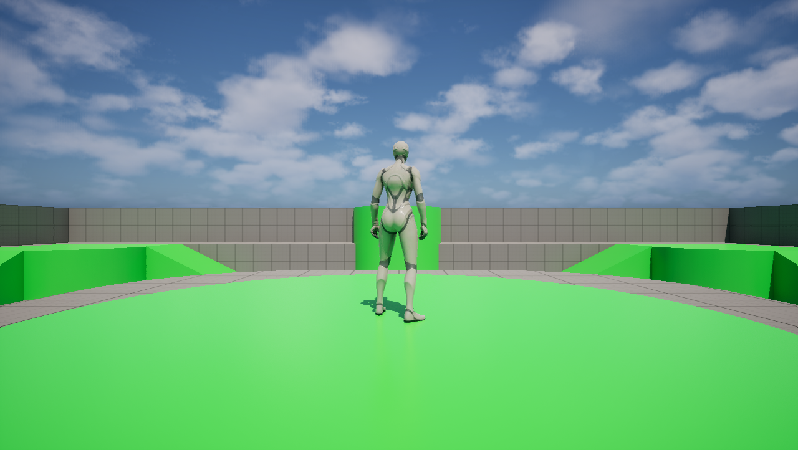
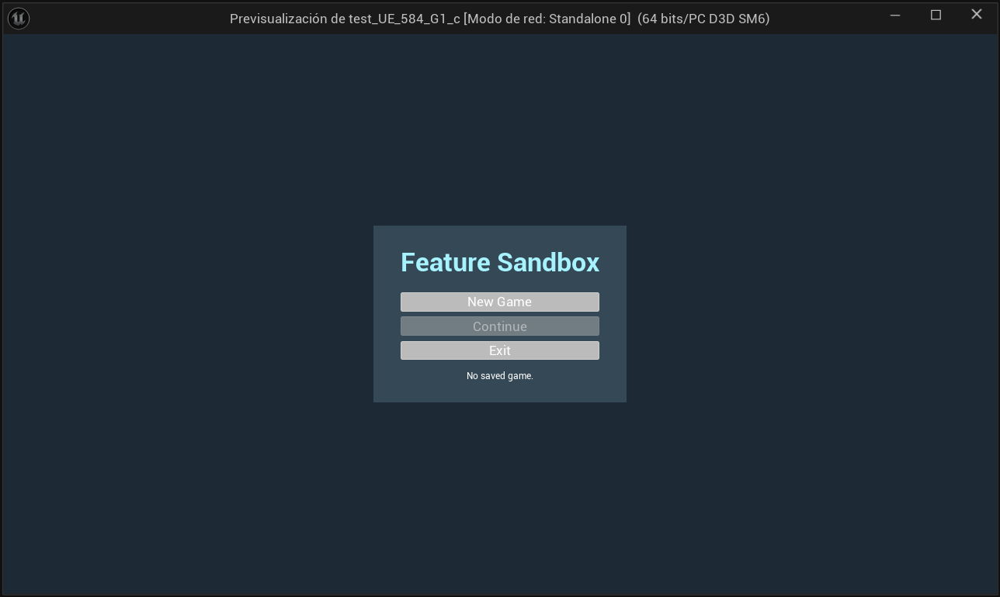
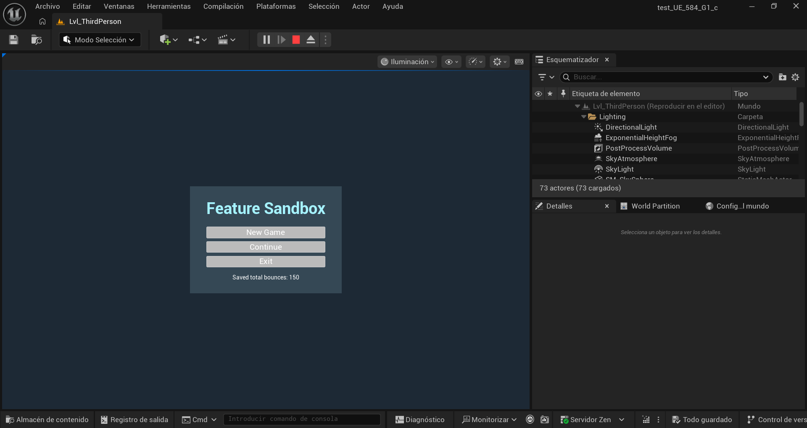
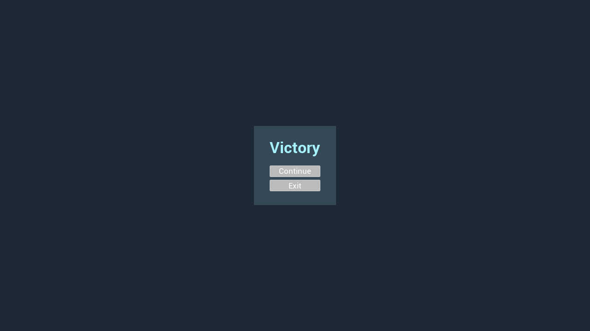
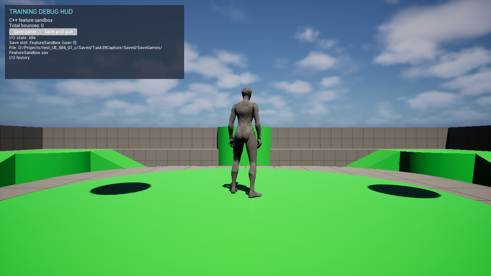
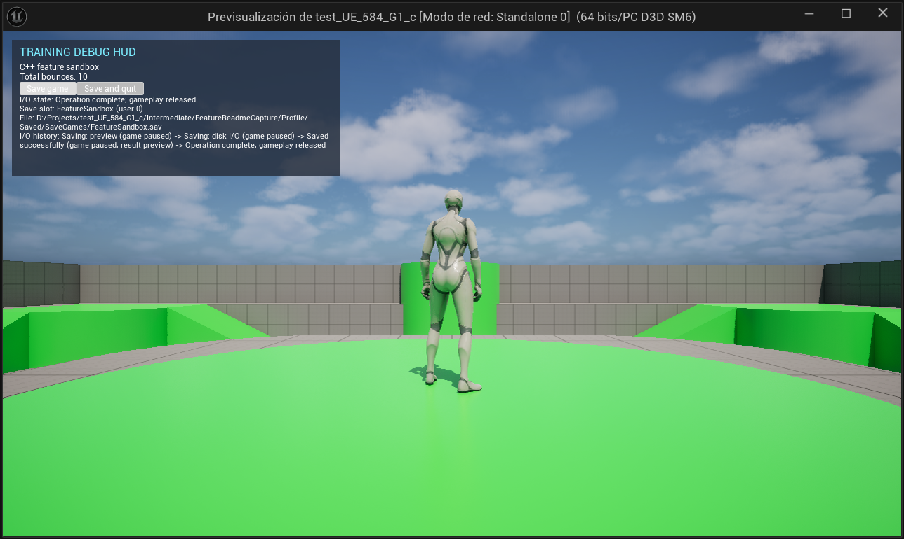
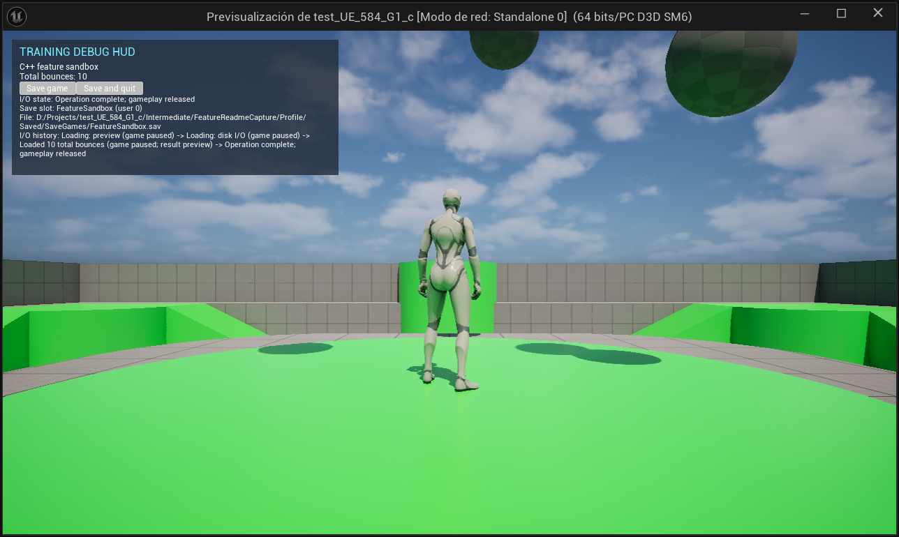

# Feature Sandbox

Step into a third-person arena, run and jump after the first volley, and watch the balls ricochet. Each round opens with a fresh mix of launch positions and trajectories. Balls disappear after five non-player bounces; player contact retires a ball and launches a replacement. You can carry your total into your next session.

## Jump into the arena

Choose **New Game** to start at zero or **Continue** to restore your saved bounce total. Use **WASD** to move, the **mouse** to look, and **Space** to jump.



*The player character stands on the arena's central platform.*

## Start fresh or pick up your count

The startup and pause menus show your last saved bounce total. When the slot is empty, the menu shows **No saved game.** and disables **Continue**.



*An empty save slot disables Continue and displays “No saved game.”*



*After saving 150 bounces, the startup menu shows the saved total and enables Continue. Captured November 7, 2026.*

During gameplay, press **Esc** to pause. Press it again or choose **Resume Game** to return to the arena. Choose **Exit** from the pause menu to save and quit. **Continue** restores your total the next time you play.

Make ten player-ball contacts before the session reaches fifty non-player bounces. The gameplay HUD shows both counts and their current session limits. The round ends with a fullscreen **Victory** or **Defeat** screen and saves the outcome. After victory, choose **Continue** to return to the initial menu; after defeat, choose **Retry** to restart the current arena. Level progression remains a planned task.

## Development

### Build and run

1. Open `test_UE_584_G1_c.uproject` in Unreal Engine 5.8 and build the editor target.
2. Open the Third Person map and press **Play**.
3. In a non-Shipping build, enter `Feature.NewGame` in the console at the startup menu to start immediately. In Play In Editor, use the Output Log command field. [Console command implementation](Source/test_UE_584_G1_c/FeatureConsoleCommands.cpp)

### Package for Win64

[Build-Win64.ps1](Build-Win64.ps1) generates project files, then packages Development, DebugGame, and Shipping together. It discovers the project's Unreal Engine version through the Windows installation registry, falling back to `D:\Program Files\Epic Games\UE_<version>`. Project and archive paths are relative to the script. Project-file generation must succeed before packaging starts.

```powershell
.\Build-Win64.ps1
```

The default archive ID is `Dev`, so repeated calls reuse `Builds\Dev`. After packaging, the script copies the latest AutomationTool `Log.txt` for this project's current run to `Build.log` in that archive, including failed packaging runs that produced a log. Reusing an ID replaces its attached log. Supply an ID to use a different archive directory:

```powershell
.\Build-Win64.ps1 -Id '1'
```

DebugGame supports debugging project C++. Each archive contains a `Windows` directory with configuration-specific launchers. Keep the staged files together when launching any of the three builds.

The asset manager registers the `GameFeatureData` cook rule required by the engine's Game Features subsystem. [Project settings](Config/DefaultGame.ini)

### Arena collision bounds

Gameplay creates one `AFeatureLevelBounds` actor with six invisible collision faces. The initial interior spans 120 × 120 × 60 meters around a center 20 meters above the world origin. Edit `Feature Bounds` in the game-mode defaults to change its center and half-size. The faces block physics balls. Balls return to the pool after five non-player bounces or player contact.

`UFeatureGameplaySession` is a world subsystem that organizes `OnGameplaySessionStart`, `OnGameplaySessionResume`, `OnGameplaySessionPaused`, and `OnGameplaySessionEnded`. Its start workflow creates the enclosure before the initial ball volley. The game mode observes lifecycle events to spawn the player and present screens. Other features can access the session through `World.GetSubsystem<UFeatureGameplaySession>()` and subscribe to its lifecycle events.


*A standalone collision-view capture shows the enclosure around the existing map. The camera was moved outside the enclosure to inspect its faces.*

### Session results

A victory or defeat pauses gameplay, saves the session, and presents the matching fullscreen result. **Continue** returns to the startup menu after victory. **Retry** reloads the arena and starts a new session after defeat.



*The session reaches Victory and offers Continue or Exit.*

### Debug HUD and save diagnostics

The non-Shipping debug HUD shows the live bounce count, the save slot and file path, and the I/O history. Its **Save game** button writes a snapshot while keeping the session open. **Save and quit** exits after a successful write.



*After the folder reorganization, `Feature.NewGame` starts gameplay and displays the debug HUD with the FeatureSandbox save slot and an initial bounce total of zero.*



*After Save game writes ten bounces, the history shows the preview, disk I/O, successful write, and return to gameplay.*



*Continue restores ten bounces. The history shows the paused load and the return to gameplay.*

Shipping builds skip the debug previews and keep gameplay paused until disk I/O finishes.

### Architecture

- **Game flow.** The gameplay session handles starting, pausing, resuming, and ending gameplay. The game mode observes its events and presents startup, gameplay, pause, victory, and defeat screens. The startup title comes from `ProjectName` in `Config/DefaultGame.ini`. A gameplay objective can call `FinishSession` to supply a result. [Gameplay session](Source/TestFeatures/Features/GameWorkflow/FeatureGameplaySession.h)
- **Physics and state.** The C++ spawner launches single balls or batches inside configurable bounds and reuses pooled actors. Five non-player bounces retire a ball; player contact retires it and schedules a replacement. Balls publish bounce events, a state controller updates the shared total, and the debug HUD observes it. The Unreal log records lifecycle events, launches, bounces, and pool returns.
- **Persistence.** The menu reads the save preview asynchronously. Session saves and loads pause gameplay during disk I/O. The debug HUD adds one-second previews before I/O and after the result and reports the slot, file path, and operation history.
- **Session history.** Saves retain a chronological array of gameplay sessions with UTC start time, bounce count, player-ball blocking-hit count, and result. New Game starts a fresh history. Continue restores it and appends a session. Resume keeps the current record.
- **Session limits.** Edit `Feature Session Limits` in the game-mode defaults. The defaults are ten player-ball contacts for victory and fifty session bounces for defeat. Reaching either limit ends gameplay and presents the fullscreen result menu. Gameplay starts with five active balls and a pool of fifteen.
- **Module boundaries.** The `TestFeatures` runtime module houses the C++ gameplay, UI, and persistence code. The project uses standard Unreal assets and has no third-party plugin dependencies. Blueprint supports supplementary logic. AngelScript use remains a project goal.

Within `TestFeatures/Features`, `Gameplay` contains balls, bounds, and bounce state. `GameWorkflow` contains session and persistence code. `UI` contains menus and HUD panels. Plain C++ spawning and storage helpers live in the sibling `Features_NonUE` folder.

- [Gameplay systems and HUD](Source/TestFeatures/Features/README.md)
- [Runtime helpers](Source/TestFeatures/Features_NonUE/README.md)
- [Project objectives and technical requirements](AGENTS.MD)
- [Completed tasks and capture index](CHANGES.md)

### Local Unreal Editor MCP

For explicitly requested editor work, open `test_UE_584_G1_c.uproject` normally. The project enables Epic's built-in MCP and toolset plugins for editor targets and starts the local server automatically. To turn off automatic startup for your local editor, clear **Auto Start Server** under **Edit → Editor Preferences → Model Context Protocol**.

The trusted project's `.codex/config.toml` points Codex at `http://127.0.0.1:8000/mcp`. If the endpoint is unavailable and Unreal Editor is closed, open the project and wait for the editor to finish loading and the local server to respond. If the current chat does not expose the Unreal tools once the server responds, start a new Codex chat in this project with the editor still open.

### Game evolution

- **Before the main menu.** The debug HUD already showed load progress and restored bounce totals. The November 1, 2026 capture shows an offscreen test that restored 96 bounces. [Historical loading HUD](docs/images/in-game-loading-hud.png)
- **First startup menu (Task 18).** New Game and Continue gave players separate ways into the arena. The menu disabled Continue when the slot was empty. The saved-total summary shown above came later. [Historical startup menu](docs/images/task-18-main-menu.jpg)
