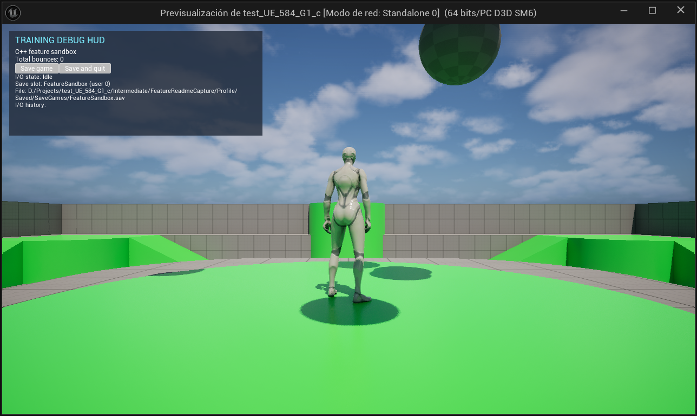

# Feature Sandbox

Step into a third-person arena, run and jump after the first volley, and watch the balls ricochet. Each round opens with a fresh mix of launch positions and trajectories. Balls disappear after their second bounce, and you can carry your total into your next session.

## Jump into the arena

Choose **New Game** to start at zero or **Continue** to restore your saved bounce total. Use **WASD** to move, the **mouse** to look, and **Space** to jump.

*The player character stands on the arena's central platform.*

## Start fresh or pick up your count

The startup and pause menus show your last saved bounce total. When the slot is empty, the menu shows **No saved game.** and disables **Continue**.

*An empty save slot disables Continue and displays “No saved game.”*

*After saving ten bounces, the startup menu shows the saved total and enables Continue.*

During gameplay, press **Esc** to pause. Press it again or choose **Resume Game** to return to the arena. Choose **Exit** from the pause menu to save and quit. **Continue** restores your total the next time you play.

## Development

### Build and run

1. Open `test_UE_584_G1_c.uproject` in Unreal Engine 5.8 and build the editor target.
2. Open the Third Person map and press **Play**.
3. In a non-Shipping build, enter `Feature.NewGame` in the console at the startup menu to start immediately. In Play In Editor, use the Output Log command field. [Console command implementation](Source/test_UE_584_G1_c/FeatureConsoleCommands.cpp)

### Debug HUD and save diagnostics

The non-Shipping debug HUD shows the live bounce count, the save slot and file path, and the I/O history. Its **Save game** button writes a snapshot while keeping the session open. **Save and quit** exits after a successful write.

*`Feature.NewGame` launched the first volley. The debug HUD shows the save slot and a fresh bounce total of zero.*

*After Save game writes ten bounces, the history shows the preview, disk I/O, successful write, and return to gameplay.*

*Continue restores ten bounces. The history shows the paused load and the return to gameplay.*

Shipping builds skip the debug previews and keep gameplay paused until disk I/O finishes.

### Architecture

- **Game flow.** The game mode owns startup, gameplay, pause, victory, and defeat. The startup title comes from `ProjectName` in `Config/DefaultGame.ini`. A future gameplay objective can call `FinishSession` to show a result screen. [Game flow states](Source/TestFeatures/Features/FeatureGameFlow.h)
- **Physics and state.** The C++ spawner launches single balls or batches inside configurable bounds and reuses pooled actors after their second bounce. Balls publish bounce events, a state controller updates the shared total, and the debug HUD observes it. The Unreal log records lifecycle events, launches, bounces, and pool returns.
- **Persistence.** The menu reads the save preview asynchronously. Session saves and loads pause gameplay during disk I/O. The debug HUD adds one-second previews before I/O and after the result and reports the slot, file path, and operation history.
- **Module boundaries.** The `TestFeatures` runtime module houses the C++ gameplay, UI, and persistence code. The project uses standard Unreal assets and has no third-party plugin dependencies. Blueprint supports supplementary logic, and an AngelScript feature is planned.

- [Gameplay systems and HUD](Source/TestFeatures/Features/README.md)
- [Runtime helpers](Source/TestFeatures/Features_NonUE/README.md)
- [Project objectives and technical requirements](AGENTS.MD)
- [Completed tasks and capture index](CHANGES.md)

### Local Unreal Editor MCP

Open `test_UE_584_G1_c.uproject` normally. The project enables Epic's built-in MCP and toolset plugins for editor targets and starts the local server automatically. To turn off automatic startup for your local editor, clear **Auto Start Server** under **Edit → Editor Preferences → Model Context Protocol**.

The trusted project's `.codex/config.toml` points Codex at `http://127.0.0.1:8000/mcp`. If the endpoint is unavailable and Unreal Editor is closed, open the project and wait for the editor to finish loading and the local server to respond. If the current chat does not expose the Unreal tools once the server responds, start a new Codex chat in this project with the editor still open.

### Game evolution

- **Before the main menu.** The debug HUD already showed load progress and restored bounce totals. The November 1, 2026 capture shows an offscreen test that restored 96 bounces. [Historical loading HUD](docs/images/in-game-loading-hud.png)
- **First startup menu (Task 18).** New Game and Continue gave players separate ways into the arena. The menu disabled Continue when the slot was empty. The saved-total summary shown above came later. [Historical startup menu](docs/images/task-18-main-menu.jpg)
