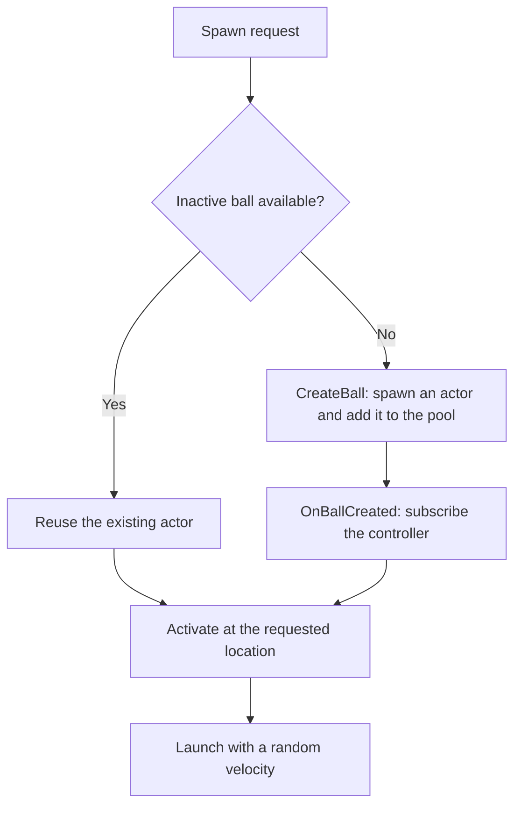
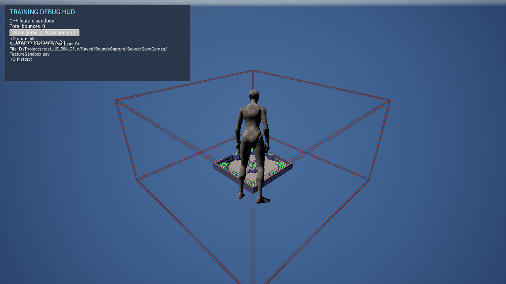

# Training balls: how this feature works

For a documentation-only assessment of efficiency, risks, and proposed improvements, see [Performance and design ideas](../../../PERFORMANCE_IDEAS.md). Those ideas are not implementation changes or measured benchmark results.

This folder is a small C++ learning example: create balls, launch them, count their bounces, and reuse them. You can follow the code without knowing Unreal's whole gameplay framework.

Start with the startup flow below. The later sections explain the event connections, object lifetime, and performance tradeoffs. Code snippets are excerpts from this project; examples that you can try are labeled separately.

## Folder organization

`Features` contains the Unreal-reflected actor and widget classes and the UObject-based state controller. The sibling `Features_NonUE` folder contains plain C++ helpers: `FFeatureBallSpawner` and `FFeatureDebugHUDSpawner`. These helpers still use Unreal APIs; non-UE here means they do not derive from UObject and are not UCLASS types.

## Who does what?

| Class | Plain-language job | Where to read |
| --- | --- | --- |
| `Atest_UE_584_G1_cGameMode` | Creates the session and observes its events to manage screens and player spawning. | [GameMode.cpp](../../test_UE_584_G1_c/test_UE_584_G1_cGameMode.cpp) |
| `UFeatureGameplaySession` | Owns gameplay lifecycle, ball spawning, bounds creation, and the state-event bridge. | [FeatureGameplaySession.cpp](FeatureGameplaySession.cpp) |
| `FFeatureBallSpawner` | Finds an available ball or creates one, and remembers the pool. | [FeatureBallSpawner.cpp](../Features_NonUE/FeatureBallSpawner.cpp) |
| `AFeatureBall` | Handles its own appearance, movement, collisions, and active/inactive state. | [FeatureBall.cpp](FeatureBall.cpp) |
| `AFeatureLevelBounds` | Contains physics balls with six collision faces spawned at session start. | [FeatureLevelBounds.cpp](FeatureLevelBounds.cpp) |
| `AFeatureGameState` | Stores the shared total number of bounces. | [FeatureGameState.cpp](FeatureGameState.cpp) |
| `UFeatureGameStateController` | Listens to ball events and updates that shared total. | [FeatureGameStateController.cpp](FeatureGameStateController.cpp) |
| `UFeatureSaveGameSubsystem` | Coordinates async persistence, pause/resume, and operation state. | [FeatureSaveGameSubsystem.cpp](FeatureSaveGameSubsystem.cpp) |
| `UFeatureDebugHUD` | Composes child panels, shared headings, layout, and debug input. | [FeatureDebugHUD.cpp](FeatureDebugHUD.cpp) |
| `UFeatureBallPanel` | Owns bounce text, initial synchronization, and game-state subscriptions. | [FeatureBallPanel.cpp](FeatureBallPanel.cpp) |
| `UFeatureSaveGamePanel` | Owns persistence controls, diagnostics, and preview timing. | [FeatureSaveGamePanel.cpp](FeatureSaveGamePanel.cpp) |
| `FFeatureDebugHUDSpawner` | Creates the debug widget and adds it to the local player's screen. | [FeatureDebugHUDSpawner.cpp](../Features_NonUE/FeatureDebugHUDSpawner.cpp) |

An **Actor** is an object that lives in Unreal's world. It need not be visible: balls and the game state are both actors. A **component** supplies part of an actor's behavior; our mesh component provides the sphere's visible shape and physical body.

The state controller and gameplay session are Unreal objects with no position or physics. The `F` spawner is a plain C++ helper stored directly inside the gameplay session.

We keep dependency knowledge close to the relationship that needs it. Balls publish events without knowing the shared state; the game-state controller translates those events into state changes. The HUD owns its own state subscription, while the player controller only manages the HUD's presence on screen. This is the general decoupling rule in `AGENTS.MD`: avoid spreading one feature's relationships into unrelated classes, without adding abstraction solely for its own sake.

For the wider framework, read Epic's [Game Mode and Game State](https://dev.epicgames.com/documentation/en-us/unreal-engine/game-mode-and-game-state-in-unreal-engine).

## 1. Pressing Play: prepare the session

The project selects `BP_ThirdPersonGameMode`, whose C++ base is our game mode. A level's GameMode Override can select a different mode, so these flows assume the Third Person mode is active.

The constructor selects the game-state **class**:

```cpp
GameStateClass = AFeatureGameState::StaticClass();
```

`StaticClass()` returns Unreal's description of the type, a `UClass*`. It does not create a game-state instance. `GameStateClass` stores that selection in `TSubclassOf<AGameStateBase>`, a wrapper that accepts compatible game-state classes.

During startup, Unreal's `AGameModeBase::PreInitializeComponents()` creates the game-state actor, registers it with the world, and calls `InitGameState()`. This happens before our game mode's `BeginPlay()`. This exact creation point is also visible in the installed engine's `Engine/Source/Runtime/Engine/Private/GameModeBase.cpp`.

Unreal creates `UFeatureGameplaySession` as a world subsystem. Our `InitGameState()` retrieves it and calls `BindGameState(State)` to connect the feature:

```cpp
GameStateController = NewObject<UFeatureGameStateController>(this);
GameStateController->Initialize(State);
BallSpawner.OnBallCreated.AddUObject(GameStateController.Get(), &UFeatureGameStateController::ObserveBall);
```

Read those lines as:

1. Create a controller object, using the gameplay session as its **Outer**, its containing Unreal object.
2. Give it the existing game state to update.
3. Tell the spawner to notify that controller whenever it creates a ball.

The world owns the session subsystem, and the session retains its controller through `UPROPERTY`. Other features retrieve the session with `World.GetSubsystem<UFeatureGameplaySession>()` to subscribe without depending on the game-mode class.

The game mode owns the current phase, defined by `EFeatureGameFlow` in [FeatureGameFlow.h](FeatureGameFlow.h). It starts in `StartupMenu` and asks [FeatureMainMenu](FeatureMainMenu.cpp) to present a game-instance-owned widget. The widget reads the title from `ProjectName`, configures viewport focus, and publishes button selections. The engine's controller is available for input routing, and the game mode defers the playable pawn. The save slot is checked when the startup menu opens. Exit at startup closes the game before a session or save operation begins.

The session groups workflows in `OnGameplaySessionStart`, `OnGameplaySessionResume`, `OnGameplaySessionPaused`, and `OnGameplaySessionEnded`. It publishes `OnStarted`, `OnResumed`, `OnPaused`, and `OnEnded(bVictory)`. The game mode subscribes during initialization and removes its bindings during `EndPlay`. New Game and Continue start the session. Resume returns from the pause menu. A successful `PauseSession()` request publishes the pause event. `FinishSession(bVictory)` publishes the result when a gameplay objective supplies an outcome.

On New Game or Continue, the session creates the enclosure and publishes `OnStarted`. The game mode enters `Gameplay` and restarts the player to spawn the pawn. The controller creates the gameplay HUD on possession. The session initializes the state at zero or requests an asynchronous restore, then creates the initial batch. Continue keeps the world paused through both I/O previews.

In non-Shipping builds, `FFeatureConsoleCommands` registers `Feature.NewGame` and routes it to the same action as the New Game button when the command's world is at the startup menu. It starts at zero and leaves the existing slot available until the session saves. [Command registration and handler](../../test_UE_584_G1_c/FeatureConsoleCommands.cpp)

```cpp
BallSpawner.SpawnMultiple(World, BallCount, SpawnBounds.Min, SpawnBounds.Max);
```

The startup order is **create state → bind session and state controller → present menu → create enclosure → spawn pawn and HUD → initialize progress and spawn balls**.

The startup and pause menus show a save summary below their buttons. An empty slot displays **No saved game.** When the slot contains a save, the menu reads it asynchronously once per opening. The menu shows the saved bounce total, including zero, or reports that the save could not be read. The preview leaves the live session state alone. Continue uses the regular session load.

During gameplay, Escape forwards a pause request through the game mode to the session. Resume Game or Escape returns to the same pawn and pool. Gameplay systems can call `FinishSession(true)` for `Victory` or `FinishSession(false)` for `Lose`. Both outcomes pause the world and show an end menu. Main Menu reloads the level, and Exit uses the in-game save-and-quit flow. The session gates pause, resume, and result transitions during persistence operations, while the game mode gates menu actions. The menu preview leaves buttons available. Menus are created on transitions and use no per-frame flow polling.

The [root README](../../../README.md) shows verified Unreal Editor captures of the empty and populated Feature Sandbox startup menus, the arena, and the debug HUD's bounce count and persistence history.

Go deeper: [UObject Instance Creation](https://dev.epicgames.com/documentation/en-us/unreal-engine/creating-objects-in-unreal-engine) explains `NewObject`; [Actor Lifecycle](https://dev.epicgames.com/documentation/en-us/unreal-engine/unreal-engine-actor-lifecycle) explains initialization and play callbacks.

## 2. Requesting a ball: create or reuse?

`SpawnMultiple()` builds an `FBox` from the minimum and maximum corners. Each iteration chooses a point with `FMath::RandPointInBox()` and calls the same public `Spawn()` used for single balls.



When creating an actor, `CreateBall()` uses:

```cpp
AFeatureBall* Ball = World.SpawnActor<AFeatureBall>(Location, FRotator::ZeroRotator, SpawnParameters);
```

Unreal constructs the actor and its inherited mesh component. The ball constructor caches that component once, loads the built-in sphere, prepares physics, and creates its bouncy material. The ball applies the material in `BeginPlay()`, when physics can update the mesh. Initially, the ball is hidden and inactive.

The spawner assigns `Training_Ball_0`, then `Training_Ball_1`, and so on, using the pool list index. It sets both the internal object name and the editor's Outliner label. It adds the actor to `SpawnedBalls` and broadcasts `OnBallCreated` before activation.

The controller's `ObserveBall()` subscribes to that actor's bounce event. Reusing the actor skips `CreateBall()`, so it also skips this subscription step. Each actor retains its original name, list slot, and listener connection.

## 3. Activation: make the ball move

`AFeatureBall::Activate()` resets the local bounce count, marks the ball active, moves it to the requested location, shows it, and enables collision and physics. It clears spin and chooses a new launch velocity:

```cpp
const FVector Direction = FMath::VRandCone(FVector::UpVector, FMath::DegreesToRadians(60.0f));
const float Speed = FMath::FRandRange(500.0f, 900.0f);
const FVector Velocity = Direction * Speed;
BallMesh->SetPhysicsLinearVelocity(Velocity);
```

The direction is inside a cone pointing upward, with a 60-degree half-angle. Speed is between 500 and 900 centimeters per second. Gravity and collisions determine the path after launch; the code does not keep steering it randomly.

The mesh's material uses restitution `0.8` and a `Max` restitution combine mode. This gives the ball a bouncy surface; it is not a fixed bounce height. See [Physical Materials Reference](https://dev.epicgames.com/documentation/en-us/unreal-engine/physical-materials-reference-for-unreal-engine) for restitution and surface interaction settings.

`BeginPlay()` and `Activate()` serve different purposes. `BeginPlay()` connects physics hit notifications once for the actor's lifetime. `Activate()` runs for every use of that actor, including pool reuse.

## 4. A bounce: from physics to the shared total

The ball's `BeginPlay()` subscribes to its mesh's physics hit event:

```cpp
BallMesh->OnComponentHit.AddDynamic(this, &AFeatureBall::OnBallHit);
```

`OnBallHit()` ignores callbacks for inactive balls and contacts with nearly zero impulse. For an accepted contact, it increments the ball's own counter and announces the bounce:

```cpp
++BounceCount;
OnBounced.Broadcast(*this);
```

The full path is:

```text
Mesh reports a hit
  -> Ball: OnBallHit()
  -> Ball: OnBounced.Broadcast(*this)
  -> Controller: HandleBallBounced(Ball)
  -> Game state: RecordBounce()
  -> TotalBounces increases by one
```

The ball knows that it bounced. It does not include or hold the game-state class, and it does not decide what the shared total means. The controller translates that notification into a state change:

```cpp
FeatureGameState->RecordBounce();
```

There are two counters with different lifetimes:

| Counter | Meaning | When it resets |
| --- | --- | --- |
| `BounceCount` on each ball | Bounces during this activation; two means return to the pool. | Every `Activate()` call. |
| `TotalBounces` on the game state | Bounces reported by all balls in the session. | Starts at zero on New Game and is restored on Continue. Pool reuse preserves the total. |

For example, starting from a saved total of zero, ball 0 bouncing twice and ball 1 bouncing once produces a shared total of three. If ball 0 is reused, its local count returns to zero while the shared total stays three. With an existing saved total, those same bounces add three to that total.

Here, a “bounce” means an accepted physics hit callback with a nonzero impulse. Wall and ball impacts can count too. If two training balls collide and both report a hit, each ball can add one to the total. We are counting ball responses, not unique pairs of colliding objects or only floor contacts.

### What does subscribing mean?

This line registers a function to call later:

```cpp
Ball.OnBounced.AddUObject(this, &UFeatureGameStateController::HandleBallBounced);
```

`this` identifies the listening controller. The `&UFeatureGameStateController::HandleBallBounced` part identifies its member function. `AddUObject()` stores a weak UObject binding. The session's strong property reference retains the controller.

`Broadcast()` invokes current listeners synchronously: the state update finishes before execution returns to `OnBallHit()`. This explains why controller and shared-total log messages can appear before the ball's own `Bounce 1/2` message. With several listeners, do not depend on their execution order.

Our `DECLARE_EVENT_OneParam` declarations restrict broadcasting to the declaring class. Other classes can subscribe. These are native C++ events; the physics hit notification instead uses a reflected dynamic delegate and an `OnBallHit()` marked `UFUNCTION()`.

Go deeper: [Multicast Delegates](https://dev.epicgames.com/documentation/en-us/unreal-engine/multicast-delegates-in-unreal-engine) covers subscription methods, weak UObject bindings, and broadcasting.

## 5. The second bounce: return to the pool

After broadcasting the second bounce, the ball calls `Deactivate()`. It becomes inactive, clears linear and angular velocity, disables physics and collision, and hides itself.

It still exists in the world and in the pool. Task 8 replaced task 7's earlier `Destroy()` behavior with this return-for-reuse behavior. `EndPlay()` is not called just because a ball is deactivated.

A later `Spawn()` request finds that inactive actor and calls `Activate()` again. No new actor, material, or event subscription is needed for that reuse.

The session requests the initial batch once. After those balls return, they wait until code calls `Spawn()` or `SpawnMultiple()` again.

### Example to try: prove that an actor is reused

Inside a gameplay-session method, the following experiment exercises explicit release and reuse. Add a direct include for `FeatureBall.h` when trying it.

```cpp
UWorld& World = *GameState->GetWorld();
AFeatureBall* First = BallSpawner.Spawn(World, FVector(0.0f, 200.0f, 500.0f));
First->Deactivate();
AFeatureBall* Reused = BallSpawner.Spawn(World, FVector(300.0f, 200.0f, 500.0f));
```

With no other available ball earlier in the pool, `First` and `Reused` point to the same actor. Its name stays the same, its location changes, and the log reports `Reusing pooled ball`. This is a temporary experiment.

## 6. Stopping Play

Stopping the session ends the world actors' play. Balls and the game state log `EndPlay()`, and the state reports its final total. Do not depend on a particular order of their shutdown logs.

The controller is a `UObject`, so it has no actor `BeginPlay()` or `EndPlay()` callbacks. It is initialized explicitly. Unreal's object lifetime system cleans it up when it is no longer referenced. Weak delegate bindings do not prolong that lifetime.

A new Play session gets a new game-mode instance, its own spawner list, a new controller, and a game state whose total is restored during paused in-game loading. The HUD remains rendered and operative during its real-time preview holds and asynchronous disk operations.

The player controller removes its debug widget in EndPlay. Interactive Save game / Save and quit operations happen before teardown so the HUD can stay operative. Editor Stop and forced teardown use a synchronous fallback without a preview.

## 7. The debug HUD: a separate UI flow

The widget layout lives in `FeatureDebugHUD.h/.cpp`, while its creation helper lives separately in `../Features_NonUE/FeatureDebugHUDSpawner.h/.cpp`. The player controller includes both headers: one for the widget instance and one for the spawning API.

The local Third Person player controller requests the overlay after New Game or Continue:

```cpp
DebugHUD = FFeatureDebugHUDSpawner::Spawn(*this);
```

This local-player check is meaningful: the screen belongs to a player on this machine, not to a remote player's controller. The helper has no dependency on the ball spawner, ball events, or game state.

`FFeatureDebugHUDSpawner::Spawn()` calls `CreateWidget<UFeatureDebugHUD>()` with the player controller as the owning player. It then calls `AddToPlayerScreen(10)` and returns the widget. The controller stores it in a `UPROPERTY`-tracked `TObjectPtr` so it remains reachable throughout the player's session. See Epic's [AddToPlayerScreen](https://dev.epicgames.com/documentation/unreal-engine/API/Runtime/UMG/UUserWidget/AddToPlayerScreen?lang=en-US) reference for player-specific viewport placement and layering.

During widget creation, `NativeOnInitialized()` builds the controls once. No Widget Blueprint asset or designer layout is needed:

```text
Player controller CreateGameplayWidgets
  -> FFeatureDebugHUDSpawner::Spawn()
  -> CreateWidget<UFeatureDebugHUD>()
  -> NativeOnInitialized() -> BuildLayout() -> BuildPanel()
  -> AddToPlayerScreen(10)
```

The widget tree contains a full-screen canvas, a dark border positioned at `(20, 20)`, and a vertical stack of debug rows and scrollable persistence diagnostics. The panel is `700 x 290` UI units before the viewport's UI scaling. The tree owns its controls; the local raw pointers in `BuildPanel()` do not require manual deletion.

The HUD is a composing manager: it decides where sections go, while each child owns the meaning of its displayed data. The ball display follows this flow:

```text
FeatureDebugHUD::BuildPanel()
  -> CreateWidget<UFeatureBallPanel>() -> add child to rows
Ball panel NativeConstruct()
  -> subscribe to game-state OnTotalBouncesChanged
  -> read GetTotalBounces() immediately
Loaded total or accepted bounce
  -> state broadcasts -> ball panel SetTotalBounces() -> label updates
Ball panel NativeDestruct()
  -> remove subscription and clear weak state reference
```

Reading the current count after subscribing covers either startup order: the panel sees a previously restored total or receives the later load event. The HUD never forwards counts or binds state events on behalf of the child. Adding another ball diagnostic belongs in FeatureBallPanel; adding another feature section belongs in the HUD composition.

`CreateText()` centralizes font and color setup. The HUD enables a visible mouse cursor and Game-and-UI input. Its outer widget uses SelfHitTestInvisible; diagnostic scrolling and save buttons remain usable while the game world is paused.

The panel displays TRAINING DEBUG HUD, C++ feature sandbox, Total bounces: N, save controls, and live persistence diagnostics. The specialized UFeatureBallPanel child connects to `AFeatureGameState::OnTotalBouncesChanged` in `NativeConstruct()` and immediately reads `GetTotalBounces()`, so it starts with the current count. `NativeDestruct()` removes the subscription and clears its weak state reference. These paired hooks support removing and re-adding the same widget without accumulating bindings; `NativeOnInitialized()` builds the layout only once. The player controller only creates, retains, and removes the overlay and has no knowledge of state events or display methods. Each local HUD observes the same session total. Updates use synchronous events rather than per-frame polling; formatting and layout invalidation happen when the count changes.

## Reading the types without getting lost

| Example from our code | How to read it |
| --- | --- |
| `UWorld& World` | Work with the existing world through a reference, without copying it. |
| `const FVector& Location` | Borrow a position for reading; this function cannot change it through that reference. |
| `AFeatureBall* Ball` | A raw pointer to a world actor; it does not mean the caller should delete it. |
| `UPROPERTY() TObjectPtr<UStaticMeshComponent> BallMesh` | A persistent Unreal-tracked reference to the existing component. |
| `TArray<TWeakObjectPtr<AFeatureBall>> SpawnedBalls` | A growable list that observes actors without keeping them alive through its references. |
| `const TArray<...>& GetSpawnedBalls() const` | Read the existing list without copying it or modifying the spawner through this method. |

`TObjectPtr` with `UPROPERTY` participates in garbage-collection tracking. A weak pointer can become invalid when its actor is destroyed; `FindAvailableBall()` checks the result of `Get()` before using it. Inactive pooled actors remain world actors even though our list is weak. Explicit actor destruction is still possible.

See [Object Pointers](https://dev.epicgames.com/documentation/en-us/unreal-engine/object-pointers-in-unreal-engine) for the full distinction. Function declarations and properties in our headers have a functional comment first and a technical comment second.

## Performance: what this design costs

These are tradeoffs visible in the implementation, not benchmark results. The current defaults use five balls; we have not measured frame time, memory usage, or a safe maximum count.

| Choice | Benefit | Cost or limitation |
| --- | --- | --- |
| Reuse inactive actors | Later requests can avoid actor creation and repeated setup. | The initial burst still creates every actor it needs. A pool offers no reuse savings until another request arrives. |
| Keep the pool for the session | Simple reuse with stable names and indices. | Inactive actors, components, and per-ball material objects retain memory. There is no pool size limit or trimming policy. |
| Scan `SpawnedBalls` | A small, readable implementation with no separate free-list bookkeeping. | Each spawn can examine the entire pool. For a batch of `B` requests and pool size `P`, searches can approach `B * P` checks, with additional checks as the pool grows. |
| Keep stable list entries | Names continue to match creation indices. | Invalid weak entries remain if actors are destroyed externally, so historical entries also increase search work. |
| Disable physics and collision while inactive | Returned balls stop simulating and colliding. | Active balls still require physics work; pooling does not make their simulation cheaper. |
| Cache `BallMesh` | Makes the dependency explicit and avoids repeated accessor calls. | `GetStaticMeshComponent()` is already a simple accessor, not a world search. Do not assume this change gives a meaningful frame-rate gain. |

The controller adds an event dispatch and a function call to each accepted bounce. Broadcasting runs listeners on the same call path; an expensive listener would delay the physics-hit handler too. We bind once per actor creation, which avoids accumulating duplicate callbacks on pool reuse. Neither the controller nor the spawner adds a polling tick loop.

The debug overlay builds its widget tree once per local player controller. It has no custom tick or per-frame state polling; only the bounce text changes when a state event arrives. UMG still has layout and rendering costs, and each local player gets a separate widget. Building UI in C++ does not automatically make the same underlying controls faster than a Widget Blueprint; here it makes creation explicit and keeps the example self-contained. The HUD visibility mode controls pointer routing, not UI drawing costs.

Logs are intentionally detailed for learning. A bounce formats several messages across the ball, controller, and state. With many active balls, string formatting and log output may be more noticeable than the counter increment or delegate call. Before increasing counts substantially, consider reducing log frequency and measuring again.

Random positions are sampled independently, and `AlwaysSpawn` allows overlapping starts. A small spawn box with many balls can produce dense contacts, more physics work, and immediate hit callbacks. The callback-based bounce counter can also consume its two hits quickly in crowded contact situations; it does not separately detect a visually completed rebound.

Each actor creates its own `UPhysicalMaterial` subobject. Pool reuse retains it, but creating a larger pool creates more material objects. A shared material asset and a free-list of available balls are possible later changes if measurements justify them. They would introduce asset management or additional bookkeeping that this example currently avoids.

The built-in sphere mesh asset is referenced by the actors; the code does not create a separate copy of its geometry for every ball. Per-actor components, physics state, and material subobjects still have their own costs.

When investigating performance, compare the same ball count, bounds, and launch settings; measure startup separately from repeated reuse. Track pool size, active count, frame time, physics time, and memory. Use Unreal's [Actor Lifecycle](https://dev.epicgames.com/documentation/en-us/unreal-engine/unreal-engine-actor-lifecycle) documentation to understand the work skipped by reuse, then profile the actual scenario rather than assuming pooling is always faster.

For a first measurement pass, use `stat unit` to inspect frame/thread timings and `stat memory` to inspect memory while playing. Compare a small batch with a larger batch, then compare a first creation burst with later reuse requests. See Epic's [Stat Commands](https://dev.epicgames.com/documentation/en-us/unreal-engine/stat-commands-in-unreal-engine) for the available counters. For a deeper timeline of work and allocation activity, start with [Unreal Insights](https://dev.epicgames.com/documentation/en-us/unreal-engine/unreal-insights-in-unreal-engine).

## Following the feature in the editor

1. Use the Third Person game mode. In its Blueprint Class Defaults, find `Training_Ball` and adjust count and minimum/maximum spawn corners. Coordinates are world centimeters; minimum must not exceed maximum on any axis.
2. Press Play, choose **New Game**, and search the World Outliner for `Training_Ball_`. Inactive pooled actors can remain listed while hidden in the game view.
3. Filter Output Log by `FeatureBallSpawner`, `FeatureBall`, `FeatureGameStateController`, or `FeatureGameState` to follow each part of the flow.
4. Look for the dark `TRAINING DEBUG HUD` panel in the top-left corner. It appears during Play through the Third Person player controller; there is no widget asset to place in the level.
5. Read the total through `GetTotalBounces()` or inspect `Total Bounces` on the game-state actor. The debug panel also displays the live total through state-change events.

This example assumes the configured training game state and controller wiring. It does not implement replication of the custom bounce total or a network event transport. `Broadcast()` here is a local C++ call, not a message sent to other machines.

For a first code-reading pass, follow [GameMode.cpp](../../test_UE_584_G1_c/test_UE_584_G1_cGameMode.cpp) → [FeatureGameplaySession.cpp](FeatureGameplaySession.cpp) → [FeatureBallSpawner.cpp](../Features_NonUE/FeatureBallSpawner.cpp) → [FeatureBall.cpp](FeatureBall.cpp) → [FeatureGameStateController.cpp](FeatureGameStateController.cpp) → [FeatureGameState.cpp](FeatureGameState.cpp).

## In-game load/save and HUD-controlled previews (tasks 14–16)

The debug HUD provides persistence controls and diagnostics in non-Shipping builds. Shipping builds use **Continue** from the startup menu and **Exit** from the pause menu for interactive persistence. The persistence subsystem contains no rendering code, sleeps, or manual Slate ticks. Storage exposes asynchronous Unreal load/save APIs and remains independent of the game state and HUD.

At `BeginPlay()`, the game state subscribes to `OnLoaded`. Choosing Continue starts the load after the HUD is created. The subsystem pauses the world and publishes the waiting phase. The HUD installs Game-and-UI input and shows the cursor. Physics waits while Slate renders the preview. New Game starts immediately with a zero total and writes the slot on the next save or normal gameplay shutdown.

The HUD's specialized UFeatureSaveGamePanel child owns a one-shot FTSTicker core-ticker callback for each one-second preview. Unlike a game-world timer or Sleep, the core ticker continues advancing while gameplay is paused and does not block rendering. Sequence: pause -> HUD preview for one real-time second -> async disk access -> apply loaded total and notify the HUD -> HUD result preview for one real-time second -> restore the previous pause state. The game must not resume until the loaded total has been applied. No separate window appears, and no delay is implemented in disk storage.

The HUD displays current I/O state, slot `FeatureSandbox`, user index 0, the absolute desktop save-file path, and operation history. History retains loading transitions before the HUD was constructed. Missing or unreadable saves complete with the existing zero fallback and a visible result. Writes report success or failure. The save contains the accumulated total, and the total stays local to the session.

Use **Save game** to save while staying in the current level. Use **Save and quit** for an orderly exit: snapshot the total, keep the world paused during preview and asynchronous saving, show the result, then quit only if the write succeeded. A failed save keeps the game open. The active HUD also intercepts a normal native game-window close and requests this path. Repeated save/close clicks do not launch competing writes; a quit request received during load is queued until a following save can complete.

Unreal Editor Stop, console/engine-forced exit, or external process termination can bypass the HUD close request. EndPlay cannot keep a destroyed level running to show progress. A synchronous fallback saves an initialized total during forced teardown, without a UI preview; stopping during initial loading does not overwrite progress with an uninitialized zero. A successful gated quit skips this redundant fallback. Crashes and forced OS process termination cannot guarantee a save. Pending async callbacks carry a generation token so results from a torn-down level are ignored; an already-issued disk write itself cannot be cancelled by that token.

The one-second preview adds approximately two seconds of paused-game time per interactive operation. The game thread is no longer deliberately slept and there are no manual renderer flushes. Unreal still serializes save data and constructs loaded objects on the game thread as part of its asynchronous API; async disk access does not make all CPU work free. Long histories still cost memory and formatting work. Shipping builds and headless runs start async I/O immediately and finish when its callback arrives. In Shipping, a native window close uses the teardown save path.

### Runtime verification checklist

Historical verification from 2026-11-01 after extracting both specialized panels. Unreal Header Tool, native compilation, and DLL linking passed. An offscreen run rendered both panels, restored 96 bounces, and logged the loading preview, asynchronous read, result preview, and gameplay release in order. The result preview lasted approximately one second. This run covered loading and recorded existing ball physics-material initialization errors and startup shader and sky warnings.

1. Start Play with a saved total: the in-game HUD should show Loading while the character and balls remain paused, then show the restored total before gameplay resumes.
2. Move the mouse and scroll the debug HUD during both one-second holds. The viewport should keep rendering; no native dialog should open.
3. Click Save game: the level remains visible, pauses, reports the real result, and resumes without leaving the map.
4. Click Save and quit or close a standalone game window: the game remains open until successful saving and its result preview finish. A write failure must keep it open.
5. Try missing saves, failed reads, repeated clicks, and close requests during loading. Existing error policy and slot sharing are unchanged.
6. Use editor Stop during loading and saving: verify the fallback and check that callbacks do not update a new level. This forced path intentionally has no in-game delay.

The player controller still only creates, retains, and removes the HUD. The outer HUD composes sections and owns general input presentation; its UFeatureBallPanel child owns bounce display and state observation. Its UFeatureSaveGamePanel child owns persistence subscriptions, diagnostic formatting, save controls, close gating, and preview callbacks. The state supplies its scalar snapshot; the subsystem owns pause/operation/quit policy; storage owns disk access. This keeps UI rendering and relationship knowledge at the appropriate boundaries.

## UI composition and documentation captures

The outer [FeatureDebugHUD](FeatureDebugHUD.cpp) composes specialized panels instead of implementing ball or persistence details. It has no game-state include, pointer, subscription, or bounce formatter. [FeatureBallPanel](FeatureBallPanel.cpp) owns its label, reads the current count on construction, listens for changes, and removes its own binding on destruction. [FeatureSaveGamePanel](FeatureSaveGamePanel.cpp) is a native UUserWidget nested inside the debug overlay. Its own lifecycle handles persistence subscriptions, close-request binding, and cancellation of pending core-ticker callbacks. The parent retains both children through UPROPERTY/TObjectPtr and adds them as normal layout sections. For example, BuildPanel creates UFeatureBallPanel with CreateWidget and adds it to the vertical rows; it never calls a bounce-specific method. The player's controller still has no save-to-widget wiring.

Include cleanup follows those boundaries too: the composing HUD no longer needs Engine/World.h, while FeatureBallPanel still includes it for its GetGameState template call. FeatureGameState no longer needs the world header either; it keeps Engine/GameInstance.h for subsystem access. Removing unused dependencies can reduce compile coupling, but does not change runtime behavior or establish a measured build-speed improvement.

This refactor changes ownership boundaries and function size, not the intended pause/I/O behavior. Each child user widget adds a small amount of object/layout bookkeeping; no per-frame polling, new window, or synchronous delay was added. Save diagnostics and controls retain the same event-driven design.

The November 7, 2026 Unreal Editor captures show ten bounces written to `FeatureSandbox` and then restored through Continue. The HUD history records the preview, disk I/O, and return to gameplay. [Save capture](../../../docs/images/feature-save-result.png) · [Continue capture](../../../docs/images/feature-continue.png)

## Runtime arena bounds

The gameplay session spawns one `AFeatureLevelBounds` before launching its balls. The actor builds six `UBoxComponent` faces around an empty interior. Adjacent faces overlap at their edges. Each face blocks the `PhysicsBody` collision channel.

The game mode exposes `FeatureLevelBoundsCenter` and `FeatureLevelBoundsHalfExtent` under `Feature Bounds`. Defaults place the center at `(0, 0, 2000)` cm with interior half-extents of `(6000, 6000, 3000)` cm. The actor also exposes its half-extents and wall thickness for inspection and editing. Six collision components add physics shapes without a per-frame update loop. Ball retirement still occurs after two bounces.



*The November 7, 2026 standalone capture shows the enclosure around the existing arena from an external inspection camera. The runtime log confirms one bounds actor and six face components with the configured dimensions.*

## Task 17 module boundary

This folder and its sibling `Features_NonUE` belong to the independent `TestFeatures` runtime module. The project game mode and player controller consume its exported API. The feature module uses only engine dependencies and its own log category, `LogTestFeatures`. Serialized references to the former module package may fail to resolve. Storage uses Unreal's `AsyncLoadGameFromSlot` and `LoadGameFromSlot`, casts to the current `UFeatureSaveGame` type, and starts at zero if no usable save is returned. Saves use Unreal's asynchronous saving API.

Historical task 17 verification with the former compatibility reader (2026-11-01): Unreal Header Tool, native compilation, and both runtime-module DLL links passed. A headless game smoke test loaded the pre-migration save total of 145, released gameplay, counted ball bounces, returned balls to their pool, and saved during orderly teardown. The original save bytes were restored after testing. The run skipped UI preview timing and logged physics-material initialization errors during class default object construction.

Historical review validation with the former compatibility reader: the adjusted storage source compiled and the TrainingFeatures DLL linked successfully. A fresh headless smoke test loaded 145 total bounces, released gameplay, and returned balls to the pool. The test process was stopped without a shutdown save. Corrupt-file recovery and UI interaction were not exercised by this follow-up.

The configured game mode and player controller create the current feature classes in code. If the save is missing or unreadable, the bounce count starts at zero. The Task 17 migration tests above used a compatibility reader that has since been removed.

Historical verification before the module rename (2026-11-01): storage compilation and module linking passed. A headless run with an isolated empty user directory started the bounce count at zero and released gameplay. This run used an empty save slot and did not exercise UI interaction or serialized asset references.
