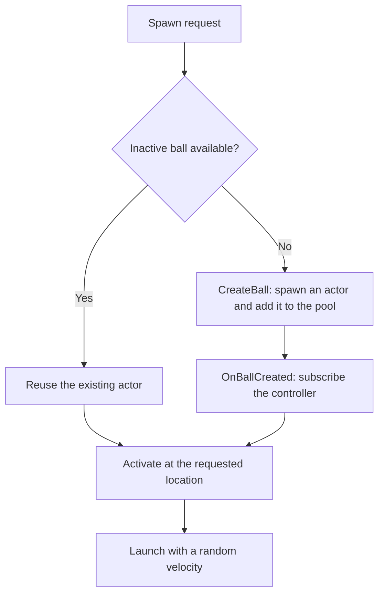

# Training balls: how this feature works

This folder is a small C++ learning example: create balls, launch them, count their bounces, and reuse them. You can follow the code without knowing Unreal's whole gameplay framework.

Start with the startup flow below. The later sections explain the event connections, object lifetime, and performance tradeoffs. Code snippets are excerpts from this project; examples that you can try are labeled separately.

## Folder organization

`Features` contains the Unreal-reflected actor and widget classes and the UObject-based state controller. The sibling `Features_NonUE` folder contains plain C++ helpers: `FTrainingBallSpawner` and `FTrainingDebugHUDSpawner`. These helpers still use Unreal APIs; non-UE here means they do not derive from UObject and are not UCLASS types.

## Who does what?

| Class | Plain-language job | Where to read |
| --- | --- | --- |
| `Atraining_UE_584_G2_cGameMode` | Sets up the session and connects the pieces. | [GameMode.cpp](../training_UE_584_G2_cGameMode.cpp) |
| `FTrainingBallSpawner` | Finds an available ball or creates one, and remembers the pool. | [TrainingBallSpawner.cpp](../Features_NonUE/TrainingBallSpawner.cpp) |
| `ATrainingBall` | Handles its own appearance, movement, collisions, and active/inactive state. | [TrainingBall.cpp](TrainingBall.cpp) |
| `ATrainingGameState` | Stores the shared total number of bounces. | [TrainingGameState.cpp](TrainingGameState.cpp) |
| `UTrainingGameStateController` | Listens to ball events and updates that shared total. | [TrainingGameStateController.cpp](TrainingGameStateController.cpp) |
| `UTrainingDebugHUD` | Builds a small non-interactive debug panel entirely in C++. | [TrainingDebugHUD.cpp](TrainingDebugHUD.cpp) |
| `FTrainingDebugHUDSpawner` | Creates the debug widget and adds it to the local player's screen. | [TrainingDebugHUDSpawner.cpp](../Features_NonUE/TrainingDebugHUDSpawner.cpp) |

An **Actor** is an object that lives in Unreal's world. It need not be visible: balls and the game state are both actors. A **component** supplies part of an actor's behavior; our mesh component provides the sphere's visible shape and physical body.

The `U` controller is an ordinary Unreal object, not a world actor or a player controller. It needs no position or physics. The `F` spawner is a plain C++ helper stored directly inside the game mode.

We keep dependency knowledge close to the relationship that needs it. Balls publish events without knowing the shared state; the game-state controller translates those events into state changes. The HUD owns its own state subscription, while the player controller only manages the HUD's presence on screen. This is the general decoupling rule in `AGENTS.MD`: avoid spreading one feature's relationships into unrelated classes, without adding abstraction solely for its own sake.

For the wider framework, read Epic's [Game Mode and Game State](https://dev.epicgames.com/documentation/en-us/unreal-engine/game-mode-and-game-state-in-unreal-engine).

## 1. Pressing Play: prepare the session

The project selects `BP_ThirdPersonGameMode`, whose C++ base is our game mode. A level's GameMode Override can select a different mode, so these flows assume the Third Person mode is active.

The constructor selects the game-state **class**:

```cpp
GameStateClass = ATrainingGameState::StaticClass();
```

`StaticClass()` returns Unreal's description of the type, a `UClass*`. It does not create a game-state instance. `GameStateClass` stores that selection in `TSubclassOf<AGameStateBase>`, a wrapper that accepts compatible game-state classes.

During startup, Unreal's `AGameModeBase::PreInitializeComponents()` creates the game-state actor, registers it with the world, and calls `InitGameState()`. This happens before our game mode's `BeginPlay()`. This exact creation point is also visible in the installed engine's `Engine/Source/Runtime/Engine/Private/GameModeBase.cpp`.

Our `InitGameState()` then connects the feature:

```cpp
TrainingGameStateController = NewObject<UTrainingGameStateController>(this);
TrainingGameStateController->Initialize(*GetGameState<ATrainingGameState>());
TrainingBallSpawner.OnBallCreated.AddUObject(TrainingGameStateController.Get(), &UTrainingGameStateController::ObserveBall);
```

Read those lines as:

1. Create a controller object, using the game mode as its **Outer**: its containing Unreal object.
2. Give it the existing game state to update.
3. Tell the spawner to notify that controller whenever it creates a ball.

The game mode's `UPROPERTY` reference keeps the controller reachable by garbage collection. The Outer relationship alone is not our keep-alive mechanism.

Finally, the game mode's `BeginPlay()` requests the initial batch:

```cpp
TrainingBallSpawner.SpawnMultiple(*GetWorld(), TrainingBallCount, TrainingBallSpawnMin, TrainingBallSpawnMax);
```

The important ordering is **create state → connect controller → spawn balls**. This is a description of our startup wiring, not a promise that every actor's `BeginPlay()` runs in a particular global order.

Go deeper: [UObject Instance Creation](https://dev.epicgames.com/documentation/en-us/unreal-engine/creating-objects-in-unreal-engine) explains `NewObject`; [Actor Lifecycle](https://dev.epicgames.com/documentation/en-us/unreal-engine/unreal-engine-actor-lifecycle) explains initialization and play callbacks.

## 2. Requesting a ball: create or reuse?

`SpawnMultiple()` builds an `FBox` from the minimum and maximum corners. Each iteration chooses a point with `FMath::RandPointInBox()` and calls the same public `Spawn()` used for single balls.



When creating an actor, `CreateBall()` uses:

```cpp
ATrainingBall* Ball = World.SpawnActor<ATrainingBall>(Location, FRotator::ZeroRotator, SpawnParameters);
```

Unreal constructs the actor and its inherited mesh component. The ball constructor caches that component once, loads the built-in sphere, prepares physics, and creates its bouncy material. Initially, the ball is hidden and inactive.

The spawner assigns `Training_Ball_0`, then `Training_Ball_1`, and so on, using the pool list index. It sets both the internal object name and the editor's Outliner label. It adds the actor to `SpawnedBalls` and broadcasts `OnBallCreated` before activation.

The controller's `ObserveBall()` subscribes to that actor's bounce event. Reusing the actor skips `CreateBall()`, so it also skips this subscription step. Each actor retains its original name, list slot, and listener connection.

## 3. Activation: make the ball move

`ATrainingBall::Activate()` resets the local bounce count, marks the ball active, moves it to the requested location, shows it, and enables collision and physics. It clears spin and chooses a new launch velocity:

```cpp
const FVector Direction = FMath::VRandCone(FVector::UpVector, FMath::DegreesToRadians(60.0f));
const float Speed = FMath::FRandRange(500.0f, 900.0f);
const FVector Velocity = Direction * Speed;
BallMesh->SetPhysicsLinearVelocity(Velocity);
```

The direction is inside a cone pointing upward, with a 60-degree half-angle. Speed is between 500 and 900 centimeters per second. Gravity and collisions determine the path after launch; the code does not keep steering it randomly.

The mesh's material uses restitution `0.8` and a `Max` restitution combine mode. This gives the ball a bouncy surface; it is not a fixed bounce height. See [Physical Materials Reference](https://dev.epicgames.com/documentation/en-us/unreal-engine/physical-materials-reference-for-unreal-engine) for restitution and surface interaction settings.

`BeginPlay()` and `Activate()` serve different purposes. `BeginPlay()` connects physics hit notifications once for the actor's lifetime. `Activate()` runs for every use of that actor, including pool reuse.

## 4. A bounce: from physics to the shared total

The ball's `BeginPlay()` subscribes to its mesh's physics hit event:

```cpp
BallMesh->OnComponentHit.AddDynamic(this, &ATrainingBall::OnBallHit);
```

`OnBallHit()` ignores callbacks for inactive balls and contacts with nearly zero impulse. For an accepted contact, it increments the ball's own counter and announces the bounce:

```cpp
++BounceCount;
OnBounced.Broadcast(*this);
```

The full path is:

```text
Mesh reports a hit
  -> Ball: OnBallHit()
  -> Ball: OnBounced.Broadcast(*this)
  -> Controller: HandleBallBounced(Ball)
  -> Game state: RecordBounce()
  -> TotalBounces increases by one
```

The ball knows that it bounced. It does not include or hold the game-state class, and it does not decide what the shared total means. The controller translates that notification into a state change:

```cpp
TrainingGameState->RecordBounce();
```

There are two counters with different lifetimes:

| Counter | Meaning | When it resets |
| --- | --- | --- |
| `BounceCount` on each ball | Bounces during this activation; two means return to the pool. | Every `Activate()` call. |
| `TotalBounces` on the game state | Bounces reported by all balls in the session. | A new game-state instance, normally a new Play session. |

For example, ball 0 bouncing twice and ball 1 bouncing once produces a shared total of three. If ball 0 is reused, its local count returns to zero while the shared total stays three.

Here, a “bounce” means an accepted physics hit callback with a nonzero impulse. Wall and ball impacts can count too. If two training balls collide and both report a hit, each ball can add one to the total. We are counting ball responses, not unique pairs of colliding objects or only floor contacts.

### What does subscribing mean?

This line registers a function to call later:

```cpp
Ball.OnBounced.AddUObject(this, &UTrainingGameStateController::HandleBallBounced);
```

`this` identifies the listening controller. The `&UTrainingGameStateController::HandleBallBounced` part identifies its member function. `AddUObject()` stores a weak UObject binding, so the event does not keep the controller alive. The game mode's strong property reference does that separately.

`Broadcast()` invokes current listeners synchronously: the state update finishes before execution returns to `OnBallHit()`. This explains why controller and shared-total log messages can appear before the ball's own `Bounce 1/2` message. With several listeners, do not depend on their execution order.

Our `DECLARE_EVENT_OneParam` declarations restrict broadcasting to the declaring class. Other classes can subscribe. These are native C++ events; the physics hit notification instead uses a reflected dynamic delegate and an `OnBallHit()` marked `UFUNCTION()`.

Go deeper: [Multicast Delegates](https://dev.epicgames.com/documentation/en-us/unreal-engine/multicast-delegates-in-unreal-engine) covers subscription methods, weak UObject bindings, and broadcasting.

## 5. The second bounce: return to the pool

After broadcasting the second bounce, the ball calls `Deactivate()`. It becomes inactive, clears linear and angular velocity, disables physics and collision, and hides itself.

It still exists in the world and in the pool. Task 8 replaced task 7's earlier `Destroy()` behavior with this return-for-reuse behavior. `EndPlay()` is not called just because a ball is deactivated.

A later `Spawn()` request finds that inactive actor and calls `Activate()` again. No new actor, material, or event subscription is needed for that reuse.

There is currently **no timer that continuously requests more balls**. The game mode requests the initial batch once. After those balls return, they wait until code calls `Spawn()` or `SpawnMultiple()` again.

### Example to try: prove that an actor is reused

Inside the game mode, where `TrainingBallSpawner` is accessible, this illustrates explicit release and reuse. Include `Features/TrainingBall.h` if calling actor methods from that file.

```cpp
ATrainingBall* First = TrainingBallSpawner.Spawn(*GetWorld(), FVector(0.0f, 200.0f, 500.0f));
First->Deactivate();
ATrainingBall* Reused = TrainingBallSpawner.Spawn(*GetWorld(), FVector(300.0f, 200.0f, 500.0f));
```

With no other available ball earlier in the pool, `First` and `Reused` point to the same actor. Its name stays the same, its location changes, and the log reports `Reusing pooled ball`. This example is an experiment to add temporarily, not another automatic flow already running in the game mode.

## 6. Stopping Play

Stopping the session ends the world actors' play. Balls and the game state log `EndPlay()`, and the state reports its final total. Do not depend on a particular order of their shutdown logs.

The controller is a `UObject`, so it has no actor `BeginPlay()` or `EndPlay()` callbacks. It is initialized explicitly. Unreal's object lifetime system cleans it up when it is no longer referenced. Weak delegate bindings do not prolong that lifetime.

A new Play session gets a new game-mode instance, its own spawner list, a new controller, and a new game-state total. The current total is not saved to disk.

The player controller also removes its debug widget from the screen in `EndPlay()`. The overlay is a widget, not an actor, so its setup uses the UMG lifecycle described below.

## 7. The debug HUD: a separate UI flow

The widget layout lives in `TrainingDebugHUD.h/.cpp`, while its creation helper lives separately in `../Features_NonUE/TrainingDebugHUDSpawner.h/.cpp`. The player controller includes both headers: one for the widget instance and one for the spawning API.

The Third Person player controller requests the overlay in its own `BeginPlay()`, only when `IsLocalPlayerController()` is true:

```cpp
DebugHUD = FTrainingDebugHUDSpawner::Spawn(*this);
```

This local-player check is meaningful: the screen belongs to a player on this machine, not to a remote player's controller. The helper has no dependency on the ball spawner, ball events, or game state.

`FTrainingDebugHUDSpawner::Spawn()` calls `CreateWidget<UTrainingDebugHUD>()` with the player controller as the owning player. It then calls `AddToPlayerScreen(10)` and returns the widget. The controller stores it in a `UPROPERTY`-tracked `TObjectPtr` so it remains reachable throughout the player's session. See Epic's [AddToPlayerScreen](https://dev.epicgames.com/documentation/unreal-engine/API/Runtime/UMG/UUserWidget/AddToPlayerScreen?lang=en-US) reference for player-specific viewport placement and layering.

During widget creation, `NativeOnInitialized()` builds the controls once. No Widget Blueprint asset or designer layout is needed:

```text
Player controller BeginPlay
  -> FTrainingDebugHUDSpawner::Spawn()
  -> CreateWidget<UTrainingDebugHUD>()
  -> NativeOnInitialized() -> BuildLayout() -> BuildPanel()
  -> AddToPlayerScreen(10)
```

The widget tree contains a full-screen canvas, a dark border positioned at `(20, 20)`, and a vertical stack of three text rows. The panel is `320 x 110` UI units before the viewport's UI scaling. The tree owns its controls; the local raw pointers in `BuildPanel()` do not require manual deletion.

`CreateText()` centralizes the font and color setup. `SetIsFocusable(false)` and `HitTestInvisible` make the overlay non-interactive, including its children: it displays information without taking keyboard focus or intercepting mouse clicks intended for gameplay.

The panel displays `TRAINING DEBUG HUD`, `C++ feature sandbox`, and `Total bounces: N`. The HUD itself connects to `ATrainingGameState::OnTotalBouncesChanged` in `NativeConstruct()` and immediately reads `GetTotalBounces()`, so it starts with the current count. `NativeDestruct()` removes the subscription and clears its weak state reference. These paired hooks support removing and re-adding the same widget without accumulating bindings; `NativeOnInitialized()` builds the layout only once. The player controller only creates, retains, and removes the overlay and has no knowledge of state events or display methods. Each local HUD observes the same session total. Updates use synchronous events rather than per-frame polling; formatting and layout invalidation happen when the count changes.

## Reading the types without getting lost

| Example from our code | How to read it |
| --- | --- |
| `UWorld& World` | Work with the existing world through a reference, without copying it. |
| `const FVector& Location` | Borrow a position for reading; this function cannot change it through that reference. |
| `ATrainingBall* Ball` | A raw pointer to a world actor; it does not mean the caller should delete it. |
| `UPROPERTY() TObjectPtr<UStaticMeshComponent> BallMesh` | A persistent Unreal-tracked reference to the existing component. |
| `TArray<TWeakObjectPtr<ATrainingBall>> SpawnedBalls` | A growable list that observes actors without keeping them alive through its references. |
| `const TArray<...>& GetSpawnedBalls() const` | Read the existing list without copying it or modifying the spawner through this method. |

`TObjectPtr` with `UPROPERTY` participates in garbage-collection tracking. A weak pointer can become invalid when its actor is destroyed; `FindAvailableBall()` checks the result of `Get()` before using it. Inactive pooled actors remain world actors even though our list is weak. Explicit actor destruction is still possible.

See [Object Pointers](https://dev.epicgames.com/documentation/en-us/unreal-engine/object-pointers-in-unreal-engine) for the full distinction. Function declarations and properties in our headers have a functional comment first and a technical comment second.

## Performance: what this design costs

These are tradeoffs visible in the implementation, not benchmark results. The current defaults use five balls; we have not measured frame time, memory usage, or a safe maximum count.

| Choice | Benefit | Cost or limitation |
| --- | --- | --- |
| Reuse inactive actors | Later requests can avoid actor creation and repeated setup. | The initial burst still creates every actor it needs. A pool offers no reuse savings until another request arrives. |
| Keep the pool for the session | Simple reuse with stable names and indices. | Inactive actors, components, and per-ball material objects retain memory. There is no pool size limit or trimming policy. |
| Scan `SpawnedBalls` | A small, readable implementation with no separate free-list bookkeeping. | Each spawn can examine the entire pool. For a batch of `B` requests and pool size `P`, searches can approach `B * P` checks, with additional checks as the pool grows. |
| Keep stable list entries | Names continue to match creation indices. | Invalid weak entries remain if actors are destroyed externally, so historical entries also increase search work. |
| Disable physics and collision while inactive | Returned balls stop simulating and colliding. | Active balls still require physics work; pooling does not make their simulation cheaper. |
| Cache `BallMesh` | Makes the dependency explicit and avoids repeated accessor calls. | `GetStaticMeshComponent()` is already a simple accessor, not a world search. Do not assume this change gives a meaningful frame-rate gain. |

The controller adds an event dispatch and a function call to each accepted bounce. Broadcasting runs listeners on the same call path; an expensive listener would delay the physics-hit handler too. We bind once per actor creation, which avoids accumulating duplicate callbacks on pool reuse. Neither the controller nor the spawner adds a polling tick loop.

The debug overlay builds its widget tree once per local player controller. It has no custom tick or per-frame state polling; only the bounce text changes when a state event arrives. UMG still has layout and rendering costs, and each local player gets a separate widget. Building UI in C++ does not automatically make the same underlying controls faster than a Widget Blueprint; here it makes creation explicit and keeps the example self-contained. `HitTestInvisible` is an input-routing choice, not a way to eliminate UI drawing costs.

Logs are intentionally detailed for learning. A bounce formats several messages across the ball, controller, and state. With many active balls, string formatting and log output may be more noticeable than the counter increment or delegate call. Before increasing counts substantially, consider reducing log frequency and measuring again.

Random positions are sampled independently, and `AlwaysSpawn` allows overlapping starts. A small spawn box with many balls can produce dense contacts, more physics work, and immediate hit callbacks. The callback-based bounce counter can also consume its two hits quickly in crowded contact situations; it does not separately detect a visually completed rebound.

Each actor creates its own `UPhysicalMaterial` subobject. Pool reuse retains it, but creating a larger pool creates more material objects. A shared material asset and a free-list of available balls are possible later changes if measurements justify them. They would introduce asset management or additional bookkeeping that this example currently avoids.

The built-in sphere mesh asset is referenced by the actors; the code does not create a separate copy of its geometry for every ball. Per-actor components, physics state, and material subobjects still have their own costs.

When investigating performance, compare the same ball count, bounds, and launch settings; measure startup separately from repeated reuse. Track pool size, active count, frame time, physics time, and memory. Use Unreal's [Actor Lifecycle](https://dev.epicgames.com/documentation/en-us/unreal-engine/unreal-engine-actor-lifecycle) documentation to understand the work skipped by reuse, then profile the actual scenario rather than assuming pooling is always faster.

For a first measurement pass, use `stat unit` to inspect frame/thread timings and `stat memory` to inspect memory while playing. Compare a small batch with a larger batch, then compare a first creation burst with later reuse requests. See Epic's [Stat Commands](https://dev.epicgames.com/documentation/en-us/unreal-engine/stat-commands-in-unreal-engine) for the available counters. For a deeper timeline of work and allocation activity, start with [Unreal Insights](https://dev.epicgames.com/documentation/en-us/unreal-engine/unreal-insights-in-unreal-engine).

## Following the feature in the editor

1. Use the Third Person game mode. In its Blueprint Class Defaults, find `Training_Ball` and adjust count and minimum/maximum spawn corners. Coordinates are world centimeters; minimum must not exceed maximum on any axis.
2. Press Play and search the World Outliner for `Training_Ball_`. Runtime balls appear during Play. Inactive pooled actors can remain listed while hidden in the game view.
3. Filter Output Log by `TrainingBallSpawner`, `TrainingBall`, `TrainingGameStateController`, or `TrainingGameState` to follow each part of the flow.
4. Look for the dark `TRAINING DEBUG HUD` panel in the top-left corner. It appears during Play through the Third Person player controller; there is no widget asset to place in the level.
5. Read the total through `GetTotalBounces()` or inspect `Total Bounces` on the game-state actor. The debug panel also displays the live total through state-change events.

This example assumes the configured training game state and controller wiring. It does not implement replication of the custom bounce total or a network event transport. `Broadcast()` here is a local C++ call, not a message sent to other machines.

For a first code-reading pass, follow [GameMode.cpp](../training_UE_584_G2_cGameMode.cpp) → [TrainingBallSpawner.cpp](../Features_NonUE/TrainingBallSpawner.cpp) → [TrainingBall.cpp](TrainingBall.cpp) → [TrainingGameStateController.cpp](TrainingGameStateController.cpp) → [TrainingGameState.cpp](TrainingGameState.cpp).
