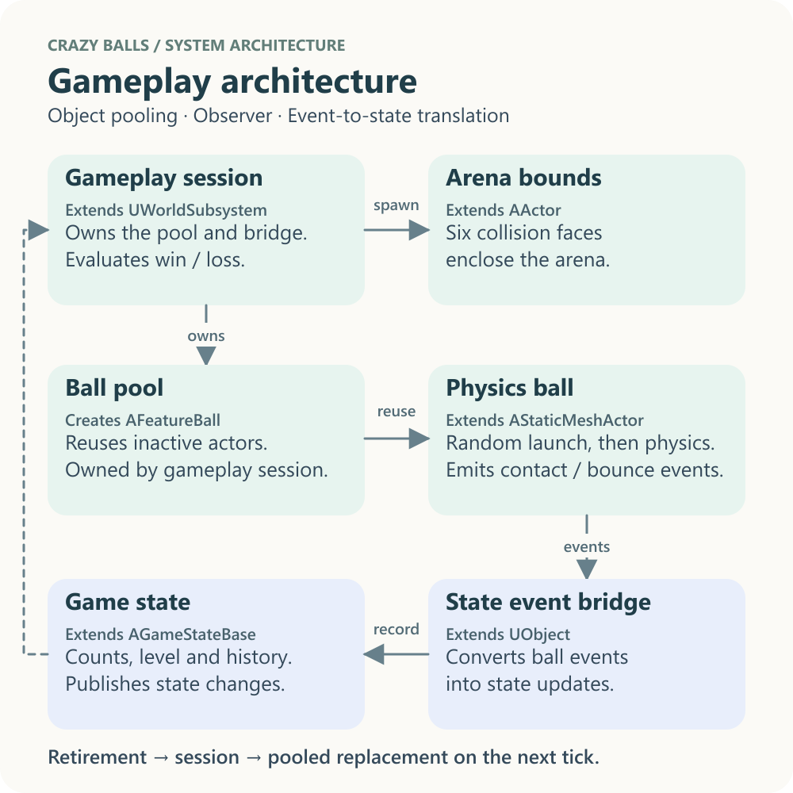
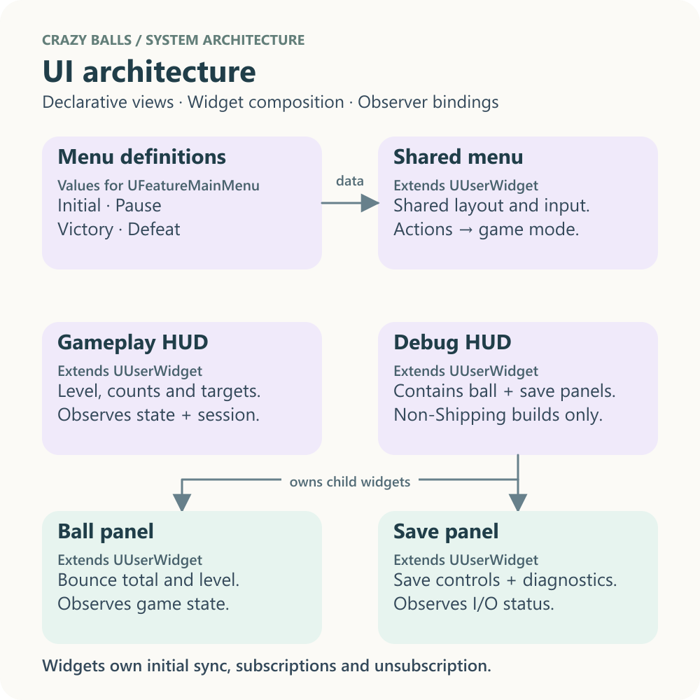
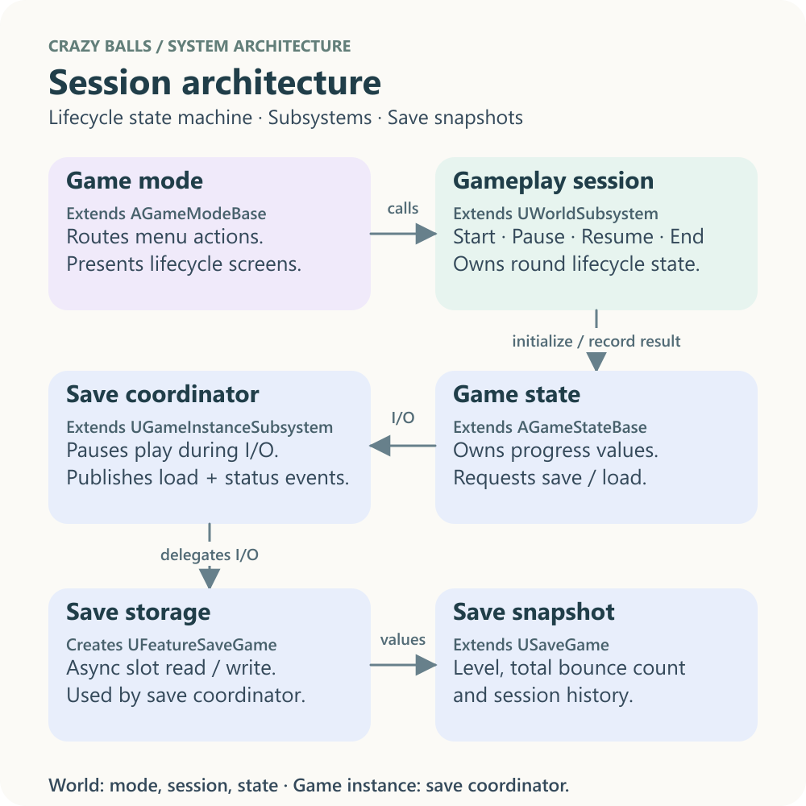

# Crazy balls: system architecture

Three square diagrams summarize system responsibilities and primary dependencies. Solid arrows show calls or data flow; dashed arrows show state observation. Expand the class references for full names and base types. These architecture diagrams complement the detailed runtime flows in [feature-flows.md](feature-flows.md).

## Gameplay architecture

Object pooling reuses actors. Observer events connect balls to the state bridge and shared state without a direct ball-to-state dependency.

Class reference

| Diagram role | Class | Base or primary consumer |
| --- | --- | --- |
| Gameplay session | `UFeatureGameplaySession` | Extends `UWorldSubsystem` |
| Arena bounds | `AFeatureLevelBounds` | Extends `AActor` |
| Ball pool | `FFeatureBallSpawner` | Creates `AFeatureBall` for `UFeatureGameplaySession` |
| Physics ball | `AFeatureBall` | Extends `AStaticMeshActor` |
| State event bridge | `UFeatureGameStateController` | Extends `UObject` |
| Game state | `AFeatureGameState` | Extends `AGameStateBase` |

Source: [session](../Source/TestFeatures/Features/GameWorkflow/FeatureGameplaySession.cpp) · [pool](../Source/TestFeatures/Features_NonUE/FeatureBallSpawner.cpp) · [ball](../Source/TestFeatures/Features/Gameplay/FeatureBall.cpp) · [state bridge](../Source/TestFeatures/Features/Gameplay/FeatureGameStateController.cpp).

## UI architecture

Declarative views share one menu implementation. The game mode manages menus; the player controller manages HUD lifetime. Widgets own their Observer bindings.

Class reference

| Diagram role | Class | Base or primary consumer |
| --- | --- | --- |
| Menu definitions | `FFeatureMenuViews` | Creates `FFeatureMenuView` values for `UFeatureMainMenu` |
| Shared menu | `UFeatureMainMenu` | Extends `UUserWidget` |
| Gameplay HUD | `UFeatureGameplayHUD` | Extends `UUserWidget` |
| Debug HUD | `UFeatureDebugHUD` | Extends `UUserWidget` |
| Ball panel | `UFeatureBallPanel` | Extends `UUserWidget` |
| Save panel | `UFeatureSaveGamePanel` | Extends `UUserWidget` |

Source: [views](../Source/TestFeatures/Features/UI/Views/FeatureMenuViews.cpp) · [menu](../Source/TestFeatures/Features/UI/Archetypes/FeatureMainMenu.cpp) · [HUDs](../Source/TestFeatures/Features/UI/Archetypes/FeatureGameplayHUD.cpp) · [panels](../Source/TestFeatures/Features/UI/Widgets/FeatureSaveGamePanel.cpp).

## Session and persistence architecture

The world subsystem owns round lifecycle. The game-instance subsystem coordinates persistence; storage creates a value snapshot from current state. The game state publishes progress that the save subsystem consumes.

Class reference

| Diagram role | Class | Base or primary consumer |
| --- | --- | --- |
| Game mode | `Atest_UE_584_G1_cGameMode` | Extends `AGameModeBase` |
| Gameplay session | `UFeatureGameplaySession` | Extends `UWorldSubsystem` |
| Game state | `AFeatureGameState` | Extends `AGameStateBase` |
| Save coordinator | `UFeatureSaveGameSubsystem` | Extends `UGameInstanceSubsystem` |
| Save storage | `FFeatureSaveGameStorage` | Creates `UFeatureSaveGame` for `UFeatureSaveGameSubsystem` |
| Save snapshot | `UFeatureSaveGame` | Extends `USaveGame` |

Source: [game mode](../Source/test_UE_584_G1_c/test_UE_584_G1_cGameMode.cpp) · [save coordinator](../Source/TestFeatures/Features/GameWorkflow/FeatureSaveGameSubsystem.cpp) · [storage](../Source/TestFeatures/Features_NonUE/FeatureSaveGameStorage.cpp) · [snapshot](../Source/TestFeatures/Features/GameWorkflow/FeatureSaveGame.h).
