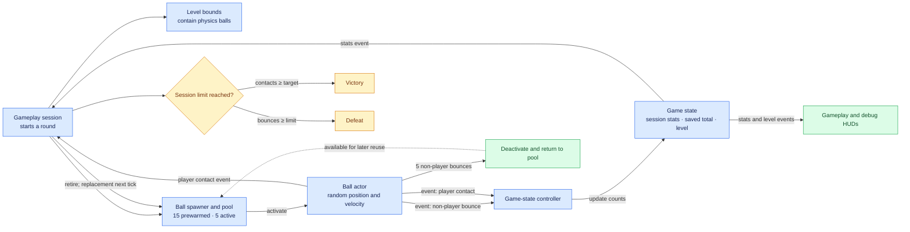
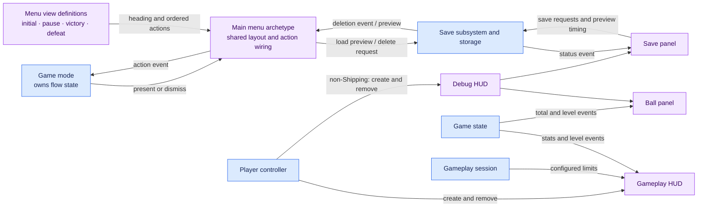
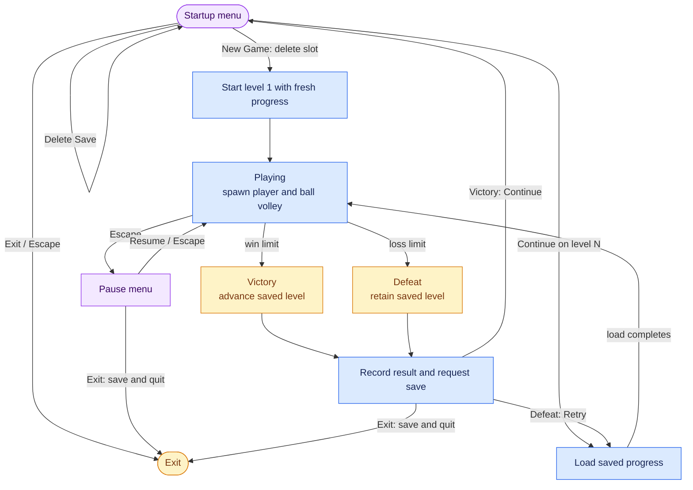

# Feature Sandbox: system flows

These diagrams show the current C++ relationships and runtime flows. Solid arrows show calls, data, or player actions; arrows labelled “event” show notifications between systems. Limits and initial pool sizes are configurable defaults.

## Gameplay: balls, contacts, and objectives

The session counts accepted non-player physics hit callbacks; one ball-to-ball collision can generate a callback for each ball. A ball retired after five bounces waits in the pool. Player contact retires a ball and schedules a replacement while the session is active. See [the ball](../Source/TestFeatures/Features/Gameplay/FeatureBall.cpp), [state controller](../Source/TestFeatures/Features/Gameplay/FeatureGameStateController.cpp), and [session](../Source/TestFeatures/Features/GameWorkflow/FeatureGameplaySession.cpp).

## UI: construction, actions, and observation

The widgets own their subscriptions and initial synchronization. The player controller manages HUD lifetime; it does not connect state events to labels. The save panel drives the non-Shipping preview timers. See [menu views](../Source/TestFeatures/Features/UI/Views/FeatureMenuViews.cpp), [menu](../Source/TestFeatures/Features/UI/Archetypes/FeatureMainMenu.cpp), and [HUD](../Source/TestFeatures/Features/UI/Archetypes/FeatureGameplayHUD.cpp).

## Game workflow: start, pause, save, and results

Persistence gates menu actions while I/O is busy and restores the prior pause state afterwards. A successful victory increments the saved level; defeat and Retry keep it. See [game mode](../Source/test_UE_584_G1_c/test_UE_584_G1_cGameMode.cpp), [session](../Source/TestFeatures/Features/GameWorkflow/FeatureGameplaySession.cpp), and [persistence subsystem](../Source/TestFeatures/Features/GameWorkflow/FeatureSaveGameSubsystem.cpp).
